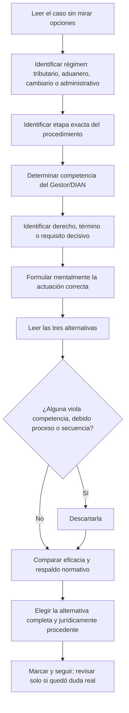
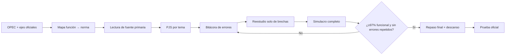

# Preparación integral para la OPEC 236767 — DIAN 2676

## Resumen ejecutivo

La **OPEC 236767** corresponde al empleo **Gestor I, código 301, grado 1**, asociado a la ficha **AT-FL-3008**, dentro del proceso misional de **Cumplimiento de Obligaciones Tributarias y Cumplimiento de Obligaciones Aduaneras y Cambiarias**, subproceso **Fiscalización y Liquidación**. La Resolución DIAN 0067 de 2024 confirma oficialmente que la ficha AT-FL-3008 corresponde a Gestor I, código 301, grado 1, en Fiscalización y Liquidación; una reproducción pública de la ficha de la OPEC 236767 vincula expresamente ese número de OPEC con AT-FL-3008 y señala que **no requiere experiencia**. citeturn29search1turn29search7

Eso es especialmente importante porque, **si tu inscripción en SIMO efectivamente aparece como modalidad Ingreso, empleo sin requisito de experiencia**, la estructura aplicable es: **Competencias Funcionales 70 %, eliminatoria, mínimo 70,00; Competencias Comportamentales 20 %; Integridad 10 %; sin Valoración de Antecedentes**. citeturn37view0turn37view3

La prueba funcional no está concebida como un examen puramente memorístico. La Guía de Orientación al Aspirante —GOA— establece un formato de **Prueba de Juicio Situacional, PJS**: se presenta un caso hipotético cercano al trabajo en la DIAN, un enunciado y **tres alternativas**, de las cuales solo una es correcta. En cambio, Comportamentales e Integridad son autoinformes de escala Likert de cuatro niveles y **no tienen respuestas correctas o incorrectas**. citeturn37view0turn37view1

Por eso, para esta OPEC la estrategia óptima no es estudiar indiscriminadamente “todo DIAN”. El núcleo de alto rendimiento es:

**determinación y control tributario → procedimiento de fiscalización y liquidación → fiscalización aduanera → régimen cambiario → fiscalización internacional → CPACA/transparencia/servicio → MIPG y gestión documental → herramientas de análisis e informes → funciones específicas AT-FL-3008 → competencias Comportamiento Ético, Adaptabilidad, Comunicación Efectiva y Trabajo en Equipo.** Esa priorización deriva directamente del propósito, funciones y competencias de la ficha AT-FL-3008. citeturn29search7turn24search0

Hay además una regla crítica de vigencia normativa: la GOA dispone que para ejes sustentados en leyes, decretos u otras normas **solo se tendrán en cuenta las que estén vigentes y hayan sido expedidas antes del 19 de junio de 2026**. citeturn37view0 Esto genera una cuestión especialmente delicada en aduanas: la **Ley 2586 de 2026 está fechada precisamente el 19 de junio de 2026**, mientras el Decreto Ley 920 de 2023 conservó efectos diferidos hasta el 20 de junio de 2026. Por lectura literal del corte de la GOA, mi criterio de preparación es estudiar para el examen el **Decreto Ley 920 de 2023** en materia sancionatoria/decomiso y no reemplazarlo por la Ley 2586 en los temas congelados por el corte. Es una inferencia fundada en las fechas y en la regla de la GOA, no una aclaración específica publicada para la OPEC 236767. citeturn35search1turn36search0

He preparado además **dos simulacros integrales paralelos de 100 ítems cada uno**, con 70 PJS funcionales, 20 ítems comportamentales y 10 de integridad, más un solucionario detallado y un plan de 23 días. El número de 100 preguntas es deliberadamente un **modelo de entrenamiento**, no una afirmación sobre el número oficial: la documentación pública consultada **no especifica cuántas preguntas tendrá el cuadernillo oficial**. La ponderación 70/20/10 tampoco significa necesariamente que el examen real tenga esa misma proporción de ítems. citeturn37view1

**Material descargable preparado para esta investigación:**

[Descargar Simulacro integral OPEC 236767 — Forma 1](sandbox:/mnt/data/Simulacro_1_OPEC_236767_DIAN_2676.pdf)

[Descargar Simulacro integral OPEC 236767 — Forma 2](sandbox:/mnt/data/Simulacro_2_OPEC_236767_DIAN_2676.pdf)

[Descargar claves, explicaciones y rúbrica detallada](sandbox:/mnt/data/Claves_Explicaciones_Rubrica_OPEC_236767.pdf)

[Descargar plan intensivo imprimible de 23 días](sandbox:/mnt/data/Plan_Estudio_OPEC_236767_23_dias.pdf)

No es posible garantizar matemáticamente un “puntaje perfecto”: la CNSC/FUAA puede excluir ítems después del análisis psicométrico y estadístico y aplica una fórmula de calificación que la GOA no publica íntegramente; además, las pruebas comportamentales e integridad no tienen una respuesta “correcta” que pueda memorizarse. Sí es realista entrenar para llegar a **97–100 % de precisión bruta repetible en PJS funcionales** y minimizar errores de lectura, términos, competencia y procedimiento. citeturn37view1

## Fuentes oficiales y perfil específico de la OPEC

### Jerarquía de fuentes que debe gobernar tu preparación

| Prioridad | Fuente | Qué debes extraer |
|---|---|---|
| **Máxima** | [SIMO — CNSC](https://simo-opec.cnsc.gov.co/) | Tu OPEC 236767 exacta, modalidad, ubicación, requisitos, constancia de inscripción, citación individual y cualquier actualización. SIMO es además el medio que la GOA ordena consultar para la citación. citeturn0search4turn37view1 |
| **Máxima** | [Página oficial CNSC — DIAN 2676](https://www.cnsc.gov.co/convocatorias/dian-2676) | Avisos, resultados, acuerdos, anexos, GOA y novedades oficiales del proceso. citeturn2search2turn32search0 |
| **Máxima** | [Acuerdo No. 21 de 7 de noviembre de 2025 — PDF](https://www.cnsc.gov.co/sites/default/files/2025-11/acuerdo-no-21-dian-2676-de-20251.pdf) | Reglas jurídicamente vinculantes del concurso, pruebas, ponderación, mínimos y exclusión. citeturn13search0 |
| **Máxima** | [Anexo técnico del proceso — PDF](https://www.cnsc.gov.co/sites/default/files/2025-11/anexo_ps-dian-2676-de-2025.pdf) | Desarrollo de las etapas, aplicación, calificación, reclamaciones y demás reglas técnicas. citeturn2search0 |
| **Máxima** | GOA de Pruebas Escritas publicada por CNSC/FUAA | Formato PJS, Likert, corte normativo, aplicación, hoja de respuestas y calificación. La CNSC anunció oficialmente su publicación en octubre de 2026. citeturn2search5turn32search1 |
| **Máxima para el temario** | Consulta de ejes/indicadores de FUAA/Areandina | Es el verdadero *blueprint* individual del empleo. La GOA ordena consultar allí los ejes asignados a cada empleo. citeturn37view0 |
| **Muy alta** | [Manual de Funciones DIAN](https://www.dian.gov.co/dian/entidad/Paginas/Manual_de_Funciones.aspx) y Resoluciones 0067/0065 de 2024 | Funciones AT-FL-3008 y competencias comportamentales vigentes. citeturn24search0turn24search1 |
| **Muy alta** | Normograma DIAN, Secretaría del Senado, Función Pública, Banco de la República, AGN | Texto primario/compilado de las normas que sustentan cada eje. |

La GOA indica este enlace para consultar los indicadores por empleo:

`http://dian-2676-areandina.com.co/indicadores-dian-2667/`

Obsérvese que la propia URL publicada en la reproducción de la GOA contiene “2667”, aunque el proceso es 2676; por esa razón debe accederse preferentemente desde la publicación oficial de CNSC/FUAA y no confiar en una URL copiada fuera de contexto. citeturn37view0

### Qué hace realmente el Gestor I AT-FL-3008

La Resolución DIAN 0067 de 2024 adopta el MERF vigente y sitúa **AT-FL-3008 — Gestor I — 301 — grado 1** dentro de **Fiscalización y Liquidación**, asociado al cumplimiento de obligaciones tributarias, aduaneras y cambiarias. La página oficial de la DIAN identifica la Resolución 0067 y la Resolución 0065 —Diccionario de Competencias Comportamentales— como parte de la normativa MERF vigente desde 2024. citeturn28view3turn24search0

La ficha pública reproducida para OPEC 236767 describe como propósito esencial ejecutar, dentro de competencia y jurisdicción, investigaciones, acciones, diligencias y trámites dirigidos a verificar el cumplimiento tributario, aduanero y cambiario y detectar evasión, elusión/abuso, contrabando y lavado de activos. Entre las funciones figuran realizar investigaciones, proyectar o proferir actos administrativos de trámite/preparatorios/de fondo, participar en acciones de fiscalización, planificar la logística de controles, elaborar informes estadísticos y de gestión, participar en determinadas diligencias de destrucción de mercancías y atender las funciones comunes del empleo. citeturn29search7

Esa misma reproducción vincula como competencias funcionales específicas:

| Núcleo | Prioridad de estudio |
|---|---:|
| **Determinación y control tributario** | Crítica |
| **Fiscalización aduanera** | Crítica |
| **Régimen cambiario en operaciones de competencia DIAN** | Muy alta |
| **Fiscalización internacional** | Muy alta |
| Generalidades del sistema tributario, aduanero y cambiario | Alta |
| Generalidades del proceso de fiscalización y liquidación | Alta |
| Evasión, elusión y contrabando | Alta |
| CPACA / procedimiento administrativo | Alta |
| Constitución, función pública, transparencia y servicio ciudadano | Media-alta |
| MIPG, gestión documental, PQRSF, herramientas informáticas | Media-alta |

La misma ficha reproducida señala como competencias comportamentales específicas del perfil **Comportamiento Ético nivel 4, Trabajo en Equipo nivel 3, Comunicación Efectiva nivel 2 y Adaptabilidad nivel 2**. Esto debe cruzarse con el **Diccionario de Competencias Comportamentales adoptado por la Resolución DIAN 0065 de 2024**, no con manuales de competencias DIAN de 2020, pues la propia DIAN informa que las resoluciones MERF de 2020 fueron anuladas y reemplazadas por el marco de 2024. citeturn29search7turn24search0

### Supuesto que debes confirmar inmediatamente

La evidencia pública consultada identifica OPEC 236767 como Gestor I AT-FL-3008 y **sin experiencia**. citeturn29search7 Sin embargo, al no poder consultar tu registro privado de inscripción en SIMO, la ponderación utilizada en esta preparación parte de esta condición:

> **Supuesto de trabajo:** OPEC 236767 = modalidad Ingreso + nivel Profesional + requisito mínimo sin experiencia + no reservada para discapacidad.

Si en tu constancia SIMO apareciera una condición distinta, **SIMO y el Acuerdo prevalecen** y cambiaría la ponderación. La GOA, por ejemplo, fija para Ingreso con experiencia 65 % funcional, 15 % comportamental, 10 % integridad y 10 % antecedentes, mientras para Ingreso sin experiencia establece 70/20/10 sin antecedentes. citeturn37view3

## Estructura oficial del examen y reglas de calificación

La siguiente tabla separa deliberadamente lo **oficialmente especificado** de lo **no especificado**.

| Aspecto | OPEC 236767 bajo supuesto “Ingreso sin experiencia” | Estado |
|---|---|---|
| Competencias Funcionales | 70 % del concurso; **eliminatoria** | Oficial. citeturn37view0 |
| Mínimo funcional | **70,00/100** | Oficial. citeturn37view0turn37view1 |
| Competencias Comportamentales | 20 %, clasificatoria | Oficial. citeturn37view0 |
| Integridad | 10 %, clasificatoria | Oficial. citeturn37view0 |
| Valoración de Antecedentes | No aplica a Ingreso sin experiencia | Oficial para esa modalidad. citeturn37view0 |
| Formato funcional | PJS: 1 caso + 1 enunciado + 3 opciones + 1 correcta | Oficial. citeturn37view0 |
| Formato comportamental | Autoinforme Likert de 4 posiciones | Oficial. citeturn37view1 |
| Formato Integridad | Autoinforme Likert de 4 posiciones | Oficial. citeturn37view1 |
| Preguntas abiertas | No aparecen dentro de los formatos descritos; la GOA presenta hoja óptica de respuestas | No se contempla en la documentación consultada. citeturn37view1 |
| Número total de preguntas | **No especificado públicamente en la GOA consultada** | No especificado. citeturn37view1 |
| Número de funcionales / comportamentales / integridad | **No especificado** | No especificado. |
| Puntaje | Escala 0–100, parte entera + dos decimales truncados | Oficial. citeturn37view1 |
| Omisiones | No se tienen en cuenta para la calificación | Oficial. citeturn37view1 |
| Doble marcación | Ítem anulado | Oficial. citeturn37view1 |
| Análisis de ítems | Puede excluirse de la calificación un ítem que no satisfaga criterios técnicos psicométricos/estadísticos | Oficial. citeturn37view1 |
| Fórmula matemática exacta | La GOA dice que se usa una fórmula para ordenar aspirantes, pero no publica en el texto consultado su expresión completa | No especificada. citeturn37view1 |
| Control en Likert | Dos subescalas de control para detectar respuestas exageradamente favorables | Oficial. citeturn37view1 |
| Fecha programada | **8 de noviembre de 2026** | GOA publicada para el proceso. citeturn38view0 |
| Inicio | 8:00 a. m.; puertas desde 7:15 a. m.; cierre 8:30 a. m. | GOA. citeturn38view0 |
| Tiempo | La GOA dice expresamente **4 horas** | Oficial en el texto de la GOA. citeturn38view0 |
| Hora de terminación | El mismo texto dice **1:00 p. m.** | También figura así en GOA. citeturn38view0 |

### La inconsistencia de horario que no debes ignorar

La GOA contiene una inconsistencia aritmética real: establece inicio oficial a las **8:00 a. m.**, dice que el aspirante tendrá **cuatro horas**, pero en la misma sección afirma que la sesión termina a la **1:00 p. m.**, intervalo de cinco horas de reloj. Incluso repite que, si existe retraso por fuerza mayor, “se respetarán las cuatro horas”. citeturn38view0

Por tanto, no planificaría la estrategia sobre la hipótesis de cinco horas. Para entrenar he utilizado **240 minutos efectivos**. El día de la prueba debes obedecer lo que finalmente figure en **tu citación SIMO y las instrucciones del jefe de salón**, pues la GOA también señala que la citación individual se consulta en SIMO. citeturn37view1turn38view0

### Lo más importante sobre la prueba Likert

No intentes descubrir una secuencia tipo “marcar siempre totalmente de acuerdo”. La GOA dice expresamente que en Comportamentales e Integridad **no existen respuestas correctas o incorrectas** y recomienda responder honestamente. Además, las dos pruebas incorporarán **subescalas de control para detectar niveles exageradamente favorables de respuesta**. citeturn37view1

Esto cambia por completo la estrategia: debes **comprender las conductas del perfil y contestar coherentemente con tu patrón real**, no falsificar un personaje “perfecto”. Entrenar sí sirve para entender los constructos, detectar afirmaciones invertidas y evitar respuestas impulsivas; memorizar una clave supuestamente ideal puede ser contraproducente.

## Temario prioritario y método para dominar las PJS

### Núcleo tributario

El **Estatuto Tributario** debe ser tu documento central. Para esta OPEC no basta conocer impuestos sustantivos; el perfil es de **fiscalización y liquidación**, por lo que tienen especial retorno los artículos sobre facultades de investigación, prueba, requerimiento especial, liquidación de revisión, firmeza, no declarantes, inspecciones, información, sanciones y discusión administrativa. El artículo 684, por ejemplo, otorga amplias facultades de fiscalización e investigación para asegurar el cumplimiento de las normas sustanciales. citeturn34search0

Estudiaría en este orden: **ET 684 → 742 y régimen probatorio → 703–714 → 715–717 → 779/782 → 647/648/651 → 720 y siguientes → RUT/facturación/soportes → abuso tributario → precios de transferencia**. El objetivo no es recitar los artículos sino poder contestar escenarios como: *¿qué actuación corresponde?, ¿qué viene antes?, ¿qué término o garantía se está vulnerando?, ¿qué prueba falta?, ¿qué acto administrativo es procedente?*

### Núcleo aduanero

La columna vertebral sigue siendo el **Decreto 1165 de 2019**, compilado por el Normograma DIAN. Allí están el régimen de aduanas y facultades de fiscalización; el artículo 591, por ejemplo, sirve como punto de entrada para estudiar las potestades de control. citeturn35search0turn35search7

Debes poder distinguir con precisión:

**control previo/simultáneo/posterior; obligado aduanero; declaración de importación/corrección/legalización/modificación; inspección; clasificación arancelaria; valoración; origen; aprehensión vs. decomiso; procedimiento sancionatorio; prueba; requerimientos; recursos; favorabilidad.** La Resolución DIAN 46 de 2019 reglamenta ampliamente el Decreto 1165 y es un complemento indispensable para los procedimientos operativos. citeturn35search2

Para el régimen sancionatorio, la cuestión temporal merece disciplina. El Normograma señala que el Decreto Ley 920 de 2023 fue declarado inexequible con efectos diferidos hasta el 20 de junio de 2026; la Ley 2586 está fechada el 19 de junio. Dado que la GOA utiliza la expresión **“expedidas antes del 19 de junio de 2026”**, he construido los simulacros con el régimen que satisface ese corte temporal cuando es necesario plantear sanciones/decomiso. citeturn35search1turn36search0turn37view0

### Cambiario e internacional

El **Decreto Ley 2245 de 2011** es una fuente obligatoria porque establece el régimen sancionatorio y el procedimiento administrativo cambiario que sigue la DIAN. citeturn35search3 A esto debes sumar el régimen de operaciones de cambio del Banco de la República: importa especialmente comprender qué operaciones se canalizan, qué información debe conservarse/reportarse, quién tiene la obligación y cómo se relacionan factura, operación comercial, declaración aduanera y flujo de divisas.

En fiscalización internacional prioriza el **régimen de precios de transferencia —ET 260-1 y siguientes—**, plena competencia, vinculación, comparabilidad, documentación comprobatoria, declaraciones informativas, convenios para evitar doble imposición, beneficiario final/RUB e intercambio de información. Aquí las PJS probablemente penalicen más una mala aplicación del principio o procedimiento que no recordar literalmente un número de artículo.

### Procedimiento transversal

La Ley 1437 de 2011 —CPACA— debe estudiarse como lenguaje transversal: **debido proceso, igualdad, imparcialidad, buena fe, moralidad, participación, responsabilidad, transparencia, publicidad, coordinación, eficacia, economía y celeridad**. Función Pública mantiene una versión normativa consultable del CPACA. citeturn34search2

Añade la **Ley 1755 de 2015** para derecho de petición, Ley 1712 de 2014 para transparencia/acceso, Ley 1581 de 2012 para datos personales, Ley 594 de 2000 para gestión documental y los artículos constitucionales 29, 83, 209 y 363. La Ley 1755 es especialmente útil para distinguir peticiones generales, solicitudes de información/documentos y consultas y sus respectivos términos. citeturn34search10

### Método de resolución PJS

Este es el flujo que recomiendo utilizar tanto durante el estudio como en el examen:

El principio práctico es **norma + etapa + competencia + debido proceso + evidencia**. Dos opciones pueden parecer razonables administrativamente, pero normalmente una será jurídicamente superior porque respeta el orden del procedimiento, usa el acto correcto, conserva la competencia o garantiza contradicción. Eso concuerda con el propósito de la PJS: medir el conocimiento aplicado al desempeño real, no la simple reproducción memorística. citeturn37view0

## Simulacros integrales específicos para OPEC 236767

Dado que el número oficial de preguntas **no fue especificado** en la GOA pública consultada, no sería riguroso inventar que el examen real tendrá 100, 120 o cualquier otro número. Para poder hacer una simulación de jornada completa adopté un **modelo de 100 ítems**, usando la ponderación de la OPEC como guía de entrenamiento, no como afirmación sobre la composición del cuadernillo oficial. citeturn37view0turn37view1

### Comparación de los dos simulacros

| Componente | Simulacro A | Simulacro B | Fundamento |
|---|---:|---:|---|
| PJS funcionales | 70 | 70 | Formato oficial PJS, 3 opciones, 1 correcta. citeturn37view0 |
| Determinación/control tributario | 22 | 22 | Competencia nuclear AT-FL-3008. citeturn29search7 |
| Fiscalización aduanera | 14 | 14 | Competencia nuclear AT-FL-3008. citeturn29search7 |
| Régimen cambiario | 8 | 8 | Competencia específica AT-FL-3008. citeturn29search7 |
| Fiscalización internacional | 6 | 6 | Competencia específica AT-FL-3008. citeturn29search7 |
| CPACA/transparencia/servicio | 6 | 6 | Competencias básicas asociadas a la ficha. citeturn29search7 |
| MIPG/documental/función pública | 6 | 6 | Competencias básicas asociadas a la ficha. citeturn29search7 |
| Evasión/elusión/contrabando/LA-FT | 4 | 4 | Propósito y funciones del empleo. citeturn29search7 |
| Herramientas/datos/informes | 4 | 4 | Competencias y función de informes del perfil. citeturn29search7 |
| Comportamentales Likert | 20 | 20 | Escala oficial de cuatro posiciones. citeturn37view1 |
| Integridad Likert | 10 | 10 | Escala oficial de cuatro posiciones. citeturn37view1 |
| Total de práctica | **100** | **100** | Supuesto de entrenamiento, no cantidad oficial |
| Tiempo objetivo | **240 min** | **240 min** | La GOA expresa cuatro horas; existe la inconsistencia horaria ya indicada. citeturn38view0 |

Los casos son originales y fueron diseñados específicamente a partir de las funciones de **Fiscalización y Liquidación**. Incluyen escenarios sobre requerimiento especial, correspondencia, prueba tributaria, firmeza, aforo, inspecciones, información exógena, correcciones, inexactitud, control posterior aduanero, declaraciones de legalización, aprehensión/decomiso, valoración, clasificación, procedimiento sancionatorio, operaciones cambiarias, precios de transferencia, RUB, CPACA, transparencia, MIPG, gestión documental, analítica e informes.

### Descargas imprimibles

**Forma A completa — 100 ítems + hoja de respuestas**

[Simulacro 1 OPEC 236767 — PDF](sandbox:/mnt/data/Simulacro_1_OPEC_236767_DIAN_2676.pdf)

**Forma B completa — 100 ítems + hoja de respuestas**

[Simulacro 2 OPEC 236767 — PDF](sandbox:/mnt/data/Simulacro_2_OPEC_236767_DIAN_2676.pdf)

**Solucionario de los 140 PJS funcionales, con explicación y referencia normativa**

[Claves, explicaciones y rúbrica — PDF](sandbox:/mnt/data/Claves_Explicaciones_Rubrica_OPEC_236767.pdf)

Las preguntas funcionales del solucionario explican **por qué** una actuación es correcta y remiten a la fuente normativa que debes repasar. Para los 60 ítems Likert de ambos simulacros no proporcioné una supuesta “respuesta correcta”, porque hacerlo sería incompatible con la propia metodología oficial: la GOA declara que no existen respuestas correctas/incorrectas y que se utilizarán subescalas de control. citeturn37view1

### Ejemplos del nivel de razonamiento que debes alcanzar

**Caso tributario.** La DIAN pretende introducir en una liquidación de revisión una glosa enteramente nueva que no figuraba en el requerimiento especial. La cuestión relevante no es si la nueva glosa “parece verdadera”, sino la **correspondencia** entre requerimiento y liquidación. La respuesta debe reconocer el artículo 711 del ET y proteger el derecho de defensa.

**Caso aduanero.** Durante una diligencia se retiene mercancía por una causal legal, pero todavía no se ha producido la decisión definitiva sobre su destino. El aspirante debe distinguir **aprehensión** de **decomiso**, no tratarlos como sinónimos.

**Caso probatorio.** Un modelo analítico de riesgo señala una probabilidad altísima de evasión. La respuesta correcta no es sancionar automáticamente; el modelo sirve para orientar/priorizar el control y después los hechos deben acreditarse en el expediente. Esto se desprende de la relación entre facultades de fiscalización del artículo 684 y el principio de determinación fundada en hechos probados del artículo 742 del ET. citeturn34search0

Ése es el tipo de distinción que separa una preparación de 70 puntos de una preparación de excelencia.

## Rúbrica y plan para perseguir el máximo puntaje

### Cómo puntuar los simulacros

La CNSC no calificará necesariamente como `aciertos ÷ preguntas × 100`; la GOA prevé análisis psicométrico/estadístico, exclusión de ítems y una fórmula matemática. citeturn37view1 Para estudiar, sin embargo, necesitas una métrica simple y estable. Usa:

\[
P_{\text{práctica funcional}} = \frac{\text{aciertos}}{70}\times100
\]

| Aciertos / 70 | Puntaje bruto práctica | Interpretación para esta meta |
|---:|---:|---|
| **70** | **100,00** | Meta final de entrenamiento |
| 68–69 | 97,14–98,57 | Excelente; revisar cada error hasta eliminar su causa |
| 65–67 | 92,86–95,71 | Alto, pero todavía no lo consideraría “cerrado” |
| 60–64 | 85,71–91,43 | Buen dominio general; faltan brechas importantes |
| 55–59 | 78,57–84,29 | Puede parecer cómodo, pero no es margen de excelencia |
| 49–54 | 70,00–77,14 | Zona de aprobación bruta; objetivo insuficiente |
| ≤48 | <70 | Reestructurar estudio |

Tu criterio de avance debe ser más exigente que el corte oficial. **No abandones un tema porque hayas obtenido 70 %.** Para aspirar al máximo, yo exigiría:

**primera fase:** ≥90 % por tema;  
**segunda fase:** ≥95 % en bloques mixtos;  
**fase final:** dos sesiones consecutivas ≥97 % y ningún error repetido por desconocimiento normativo.

### Bitácora de errores

Cada error funcional debe quedar clasificado en una sola causa raíz:

| Código | Causa | Corrección |
|---|---|---|
| N | No conocía la norma/concepto | Leer fuente primaria y hacer tarjeta |
| S | Confundí secuencia procedimental | Dibujar flujo del procedimiento |
| C | Confundí competencia | Anotar quién puede hacer qué |
| T | Fallé un término/requisito | Tabla de términos y condiciones |
| P | Fallé valoración probatoria | Volver a evidencia, carga y contradicción |
| L | Leí mal el caso | Practicar lectura activa |
| D | Caí en distractor absoluto | Identificar palabras “siempre”, “nunca”, “automáticamente” |
| R | Error repetido | Crear 3 preguntas nuevas sobre el mismo punto |

El verdadero objetivo no es acumular preguntas: es llevar los **errores repetidos a cero**.

### Plan intensivo desde el 16 de octubre hasta el examen

Quedan aproximadamente tres semanas efectivas hasta el 8 de noviembre. La propuesta completa supone unas **89 horas de preparación concentrada**, además de la prueba oficial.

| Periodo | Horas | Objetivo |
|---|---:|---|
| 16–18 oct | 12 | ET: facultades, prueba, requerimiento, liquidaciones, firmeza, sanciones |
| 19–21 oct | 12 | Decreto 1165 + régimen sancionatorio aduanero conforme al corte |
| 22–23 oct | 8 | Cambiario: Decreto Ley 2245 + operaciones de cambio |
| 24–25 oct | 8 | Fiscalización internacional: precios de transferencia, RUB, CDI |
| 26–27 oct | 8 | CPACA, Constitución, petición, transparencia, función pública |
| 28 oct | 4 | MIPG, gestión documental, herramientas e informes |
| 29 oct | 4 | MERF AT-FL-3008 completo; enlazar cada función con sus normas |
| 30 oct | 4 | Comportamentales + Integridad, Res. 0065/2024 |
| 31 oct | 4 | **Simulacro 1 en condiciones reales** |
| 1–2 nov | 8 | Remediación exclusiva de las tres peores brechas |
| 3 nov | 4 | **Simulacro 2 en condiciones reales** |
| 4–5 nov | 8 | Remediación final + preguntas PJS difíciles |
| 6 nov | 3 | 30 PJS de precisión + comprobar citación/logística |
| 7 nov | 2 | Repaso ligero de errores; nada nuevo |
| 8 nov | — | Examen |

[Descargar el cronograma imprimible](sandbox:/mnt/data/Plan_Estudio_OPEC_236767_23_dias.pdf)

La preparación puede visualizarse así:

### Distribución óptima de las 89 horas

Mi asignación recomendada es: **24 horas tributario, 18 aduanero, 8 cambiario, 8 fiscalización internacional, 8 CPACA/Constitución/transparencia, 7 MIPG-documental-datos, 5 comportamental/integridad, 8 horas para dos simulacros completos y 3 horas adicionales de remediación de precisión**. Esta distribución no pretende representar porcentajes oficiales por eje —esos no están publicados en la documentación accesible—, sino maximizar retorno según la función central AT-FL-3008. citeturn29search7turn37view0

## Material de estudio recomendado y estrategia de última milla

### Biblioteca oficial mínima

**CNSC / reglas del concurso**

[Proceso oficial DIAN 2676 — CNSC](https://www.cnsc.gov.co/convocatorias/dian-2676) citeturn2search2

[SIMO](https://simo-opec.cnsc.gov.co/) citeturn0search4

[Acuerdo No. 21 de 2025 — PDF](https://www.cnsc.gov.co/sites/default/files/2025-11/acuerdo-no-21-dian-2676-de-20251.pdf) citeturn13search0

[Anexo del proceso — PDF](https://www.cnsc.gov.co/sites/default/files/2025-11/anexo_ps-dian-2676-de-2025.pdf) citeturn2search0

La GOA debe leerse completa. Además de la metodología de preguntas, contiene reglas prácticas importantes: lápiz negro No. 2, una sola respuesta por ítem, omisiones no calificadas, restricciones de dispositivos y causales de fraude/exclusión. citeturn37view1turn38view0

**DIAN / perfil**

[Manual Específico de Requisitos y Funciones — DIAN](https://www.dian.gov.co/dian/entidad/Paginas/Manual_de_Funciones.aspx) citeturn24search0

[Resolución DIAN 0067 de 11 de abril de 2024 — PDF](https://www.dian.gov.co/normatividad/Normatividad/Resoluci%C3%B3n%20000067%20de%2011-04-2024.pdf) — confirma AT-FL-3008 como Gestor I en Fiscalización y Liquidación. citeturn29search1turn28view3

En la página del Manual de Funciones está también la **Resolución 0065 de 2024 — Diccionario de Competencias Comportamentales**, fuente prioritaria para Comportamiento Ético, Adaptabilidad, Comunicación Efectiva y Trabajo en Equipo. citeturn24search0

**Tributario**

[Estatuto Tributario — Secretaría del Senado, sección que contiene art. 684](https://www.secretariasenado.gov.co/senado/basedoc/estatuto_tributario_pr028.html) citeturn34search0

No lo estudies linealmente desde el artículo 1. Construye primero un mapa del procedimiento de fiscalización y luego ve abriendo cada artículo desde ese mapa.

**Aduanero**

[Decreto 1165 de 2019 — Normograma DIAN](https://normograma.dian.gov.co/dian/compilacion/docs/decreto_1165_2019.htm) citeturn35search0

[Resolución DIAN 46 de 2019](https://normograma.dian.gov.co/dian/compilacion/docs/resolucion_dian_0046_2019.htm) citeturn35search2

[Decreto Ley 920 de 2023 — Normograma](https://normograma.dian.gov.co/dian/compilacion/docs/decreto_0920_2023.htm) citeturn35search1

La actual **Ley 2586 de 2026** es importante para el ejercicio profesional actual, pero debido al corte literal que fija la GOA no la utilizaría para reemplazar automáticamente el régimen congelado para este examen. citeturn36search0turn37view0

**Cambiario**

[Decreto Ley 2245 de 2011 — Normograma DIAN](https://normograma.dian.gov.co/dian/compilacion/docs/decreto_2245_2011.htm) citeturn35search3

**Procedimiento administrativo**

[Ley 1437 de 2011 — CPACA, Gestor Normativo Función Pública](https://www.funcionpublica.gov.co/eva/gestornormativo/norma.php?i=41249) citeturn34search2

[Ley 1755 de 2015 — Derecho de petición](https://www.funcionpublica.gov.co/eva/gestornormativo/norma.php?i=65334) citeturn34search10

### Material complementario de práctica

Los ejemplos de la propia GOA son el mejor material para aprender **cómo redacta el operador una PJS**: la guía muestra casos, enunciado, tres alternativas, clave y justificación para cada opción. Es más valioso estudiar la estructura lógica de esos ejemplos que memorizar su contenido. citeturn37view0

Como complementos no oficiales existen plataformas que ya organizan contenidos específicos para Gestor de Fiscalización y Liquidación, incluida OPEC 236767. Por ejemplo, Conquista Tu Plaza publica un temario que abarca fiscalización tributaria, aduanera, sistema cambiario, CPACA, MIPG, gestión documental, comportamiento e integridad; sirve sobre todo como **mapa complementario**, no como autoridad frente a CNSC/SIMO. citeturn30search4

Simotest y Mérita también publican actualmente guías orientadas a DIAN 2676 y reconocen tanto el corte normativo como el formato PJS. Deben utilizarse para obtener práctica adicional después de dominar las fuentes primarias, no para sustituirlas. citeturn36search1turn36search7

### Reglas de oro para las últimas semanas

**Primero, función antes que norma.** Toma cada una de las funciones de AT-FL-3008 y pregúntate qué normas la habilitan, qué documentos genera, qué límites tiene y qué error procedimental la invalida. El examen pretende evaluar competencias vinculadas al contenido funcional del empleo. citeturn37view0

**Segundo, estudia por decisiones.** En lugar de una ficha que diga “ET 703 = requerimiento especial”, crea una ficha que diga: *“Quiero modificar una declaración privada mediante liquidación de revisión: ¿qué actuación debe precederla y por qué?”*. Esa forma reproduce la PJS.

**Tercero, domina las diferencias cercanas.** Requerimiento ordinario vs. especial; liquidación de revisión vs. aforo; inspección tributaria vs. contable; corrección voluntaria vs. provocada; aprehensión vs. decomiso; corrección vs. legalización aduanera; fiscalización tributaria vs. cambiaria; reserva vs. transparencia; hecho probado vs. indicador de riesgo. Esas parejas generan distractores excelentes.

**Cuarto, jamás sacrifiques debido proceso por “eficiencia”.** Muchas alternativas incorrectas parecerán rápidas y útiles —sancionar de inmediato, corregir de oficio sin trámite, ignorar contradicción, ampliar competencia—, pero el artículo 29 constitucional y los principios del CPACA siguen siendo transversales. citeturn34search2

**Quinto, en Likert no actúes un personaje.** La propia GOA aconseja honestidad y anuncia controles contra respuestas exageradamente favorables. Estudia qué significan tus competencias y niveles, pero conserva consistencia entre afirmaciones equivalentes o invertidas. citeturn37view1

**Sexto, utiliza los últimos dos simulacros como instrumentos diagnósticos, no como entretenimiento.** Por cada 70 preguntas funcionales, una sesión de revisión puede aportar más que hacer otras 70 sin analizar por qué te equivocaste.

**Séptimo, los días finales no son para ampliar el temario.** Al 6 de noviembre tu biblioteca debe estar cerrada. El día 7 conviene repasar solo la bitácora de errores, artículos críticos y flujos; el examen exige cuatro horas de concentración según la GOA y el rendimiento cognitivo ese día vale tanto como unas horas adicionales de lectura desordenada. citeturn38view0

La meta operativa más exigente y medible es llegar al 7 de noviembre pudiendo resolver **dos formas completas con al menos 68/70 PJS funcionales, sin errores repetidos, dentro del tiempo**, y haber alcanzado 70/70 varias veces en bloques temáticos. Eso no garantiza un 100 oficial —la metodología de calificación no permite prometerlo—, pero coloca la preparación exactamente donde debe estar para competir por el extremo superior de la distribución: **dominio normativo aplicado, precisión procedimental, velocidad de lectura y cero errores evitables**.