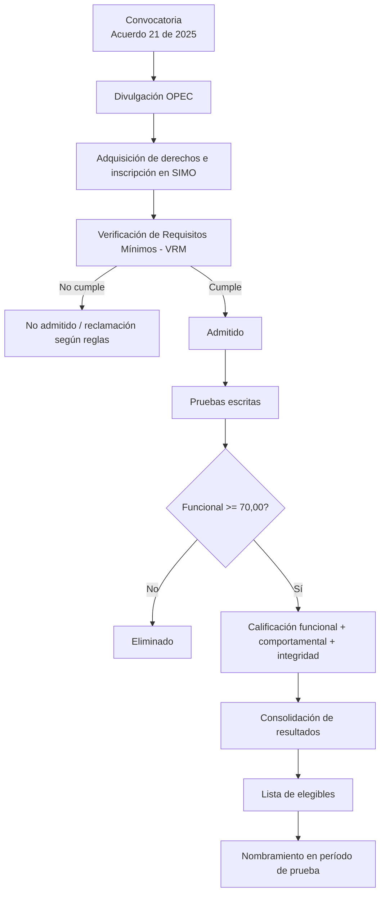
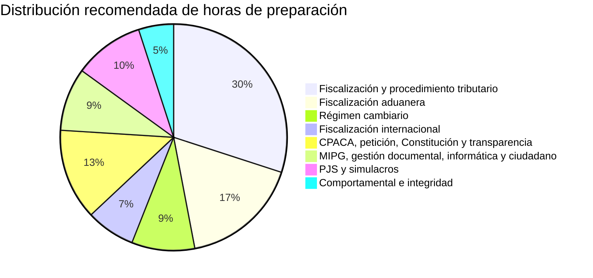
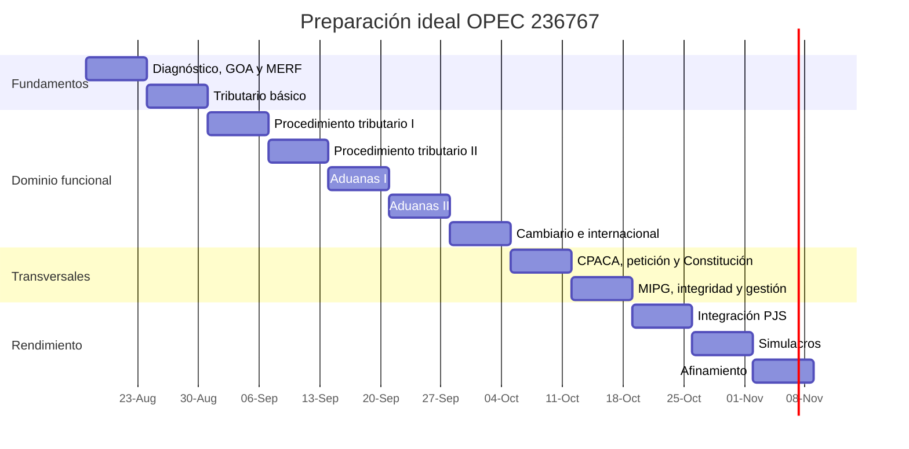

# Informe de investigación: OPEC 236767 — Gestor I, Fiscalización y Liquidación, DIAN 2676

## Resumen ejecutivo

La **OPEC 236767** pertenece al Proceso de Selección **DIAN 2676 de 2025** y corresponde al empleo **Gestor I, código 301, grado 1**, nivel profesional, asociado a la ficha **AT-FL-3008**, subproceso de **Fiscalización y Liquidación**, dentro de los procesos misionales de cumplimiento de obligaciones tributarias y de obligaciones aduaneras y cambiarias. La existencia y clasificación de la ficha AT-FL-3008 provienen del Manual Específico de Requisitos y Funciones —MERF— adoptado por la DIAN mediante la Resolución 000067 del 11 de abril de 2024; la OPEC 236767 aparece públicamente vinculada a esa ficha en la oferta del proceso. citeturn40search3turn40search2turn30search3

Para esta ficha, la información pública del MERF indica **título profesional en determinados Núcleos Básicos del Conocimiento, sin experiencia mínima**, tarjeta profesional cuando la ley la exija y sin aplicación de equivalencias. Los NBC relacionados comprenden Administración; Ciencia Política y Relaciones Internacionales; Contaduría Pública; Derecho y afines; Economía; Ingeniería Administrativa y afines; Ingeniería de Sistemas, Telemática y afines; Ingeniería Industrial y afines; Ingeniería Química y afines; y Matemáticas, Estadística y afines. citeturn18search13turn40search2

La ficha publicada contiene una condición especial relacionada con **inglés B2 para empleos ubicados en la Subdirección de Gestión de Fiscalización Internacional**. No es correcto convertir esa frase automáticamente en un requisito B2 para todas las plazas de OPEC 236767: la condición depende de la ubicación del empleo. Ante cualquier diferencia entre copias del MERF y la información individual de inscripción, la constancia/OPEC que figure en SIMO es la referencia operativa que debe revisarse. citeturn18search13turn26search11

Para una OPEC de **Ingreso que no exige experiencia**, la estructura publicada para DIAN 2676 es especialmente favorable a quien domine el examen: **Competencias Funcionales 70% —eliminatoria, mínimo 70,00—; Competencias Comportamentales 20%; Integridad 10%; y sin Valoración de Antecedentes**. Las pruebas se califican de 0 a 100 con dos decimales truncados; la fórmula matemática concreta con la que se transforman las respuestas en puntuaciones **no está publicada** en las fuentes examinadas. Los ítems además pasan por análisis psicométrico y estadístico, por lo que algunos pueden excluirse de la calificación. citeturn16view0turn16view1turn23view0turn29search7

**Situación a 16 de octubre de 2026:** las inscripciones de Ingreso ya terminaron —se habían programado del 28 de enero al 6 de febrero y finalmente se ampliaron hasta las 23:59 del 7 de febrero de 2026—; la CNSC anunció la publicación de resultados de Verificación de Requisitos Mínimos para el **14 de octubre de 2026**; y ya publicó el aviso de la Guía de Orientación al Aspirante —GOA— para las pruebas escritas. citeturn28search4turn28search3turn28search0turn29search2

El texto de la GOA publicado/reproducido públicamente fija la prueba escrita para el **domingo 8 de noviembre de 2026**, en una sola sesión. Existe, sin embargo, una inconsistencia interna que conviene tratar con cautela: la guía dice expresamente que el aspirante dispone de **cuatro horas**, pero también señala inicio a las 8:00 a. m. y finalización a la 1:00 p. m., que son cinco horas cronológicas. Para entrenamiento recomiendo asumir solo **240 minutos efectivos**, y el día del examen obedecer la citación de SIMO y las instrucciones del jefe de salón. citeturn29search2turn29search7

Otro punto decisivo: la GOA establece que, para ejes sustentados en leyes, decretos u otras normas, se tendrán en cuenta las que estuvieran vigentes y hubieran sido expedidas **antes del 19 de junio de 2026**. El Normograma DIAN visible hoy ya incorpora normas posteriores a esa fecha; por ello, estudiar indiscriminadamente la versión “más reciente” puede inducir errores para esta prueba. Hay que construir una **fotografía normativa al corte oficial del 19 de junio de 2026**. citeturn24view0turn36search0turn36search18

La consecuencia estratégica es clara: para OPEC 236767 el objetivo primario es superar holgadamente el 70,00 funcional y, después, maximizar posición relativa. Como el componente funcional vale el 70% del total, una mejora de diez puntos allí vale aproximadamente **siete puntos en el ponderado**, mientras que diez puntos adicionales en comportamental aportan dos y en integridad uno. Esta aritmética se desprende de los pesos oficiales para empleos de Ingreso sin experiencia. citeturn24view0turn29search11

No existe una forma seria de garantizar un “puntaje perfecto”. Particularmente, Comportamentales e Integridad son instrumentos de autoinforme sin una clave convencional de respuestas correctas y contienen **subescalas de control destinadas a detectar patrones exageradamente favorables**. Intentar marcar sistemáticamente la alternativa aparentemente “más virtuosa” puede ser contraproducente. citeturn25view0turn23view0turn29search7

| Decisión estratégica | Recomendación |
|---|---|
| Meta mínima funcional | Nunca entrenar “para sacar 70”. Meta de simulacro: **≥90/100** |
| Prioridad | Fiscalización y determinación tributaria → aduanera → cambiaria → internacional → ejes transversales |
| Formato a dominar | **Prueba de Juicio Situacional, PJS**, con caso, enunciado y tres opciones |
| Corte normativo | Construir apuntes con legislación aplicable **hasta 19-jun-2026** |
| Comportamental/integridad | Honestidad + consistencia; no intentar descubrir una “clave ideal” |
| Simulación | Jornada conservadora de **4 horas**, en papel y con lápiz No. 2 |
| Últimas semanas | Más recuperación activa, PJS y simulacros; menos lectura pasiva |
| Riesgo principal | Conocer normas de memoria pero no saber aplicarlas a un expediente o actuación |

## Proceso oficial, requisitos, etapas, cronograma y puntuación

El documento rector es el **Acuerdo No. 21 del 7 de noviembre de 2025**, complementado por su **Anexo Técnico**. La propia CNSC señala que estos instrumentos fijan las reglas del Proceso de Selección DIAN 2676, convocado para proveer empleos de carrera bajo el sistema específico de la DIAN. citeturn31search0turn31search1turn31search5turn31search7

El marco superior es el Decreto 927 de 2023, que regula el sistema específico de carrera de la DIAN. Su artículo 32 contempla las etapas del proceso de selección para ingreso y ascenso. citeturn35search1

**Identificación del empleo.** El núcleo de OPEC 236767 puede resumirse así:

| Campo | OPEC 236767 |
|---|---|
| Entidad | Dirección de Impuestos y Aduanas Nacionales — DIAN |
| Proceso | DIAN 2676 de 2025 |
| Modalidad analizada | Ingreso |
| Denominación | Gestor I |
| Código / grado | 301 / 1 |
| Nivel | Profesional |
| Ficha MERF | AT-FL-3008 |
| Proceso misional | Cumplimiento de obligaciones tributarias y cumplimiento de obligaciones aduaneras y cambiarias |
| Subproceso | Fiscalización y Liquidación |
| Experiencia mínima | **No exige experiencia** |
| Equivalencias | No contempladas en la ficha consultada |
| Tarjeta profesional | Cuando la ley la exija |
| Idioma | B2 aparece condicionado a empleos ubicados en Fiscalización Internacional; no debe extrapolarse a todas las plazas |
| Número oficial de vacantes que pude confirmar directamente en fuente primaria | **No especificado en una página primaria accesible en la investigación**; publicaciones secundarias indexadas mencionan 189, pero recomiendo tratar esa cifra como secundaria |

La clasificación funcional y los requisitos se apoyan en el MERF de la DIAN y en la ficha pública de AT-FL-3008; la relación concreta OPEC 236767 ↔ AT-FL-3008 aparece en las listas públicas indexadas del proceso. citeturn40search2turn40search3turn30search3turn18search13

El **propósito** del empleo, en sustancia, consiste en ejecutar investigaciones, actuaciones, diligencias y trámites dirigidos a verificar el cumplimiento de las obligaciones tributarias, aduaneras y cambiarias y contribuir a detectar fenómenos como evasión, elusión, abuso, contrabando y operaciones relacionadas con lavado de activos. Entre las funciones asociadas aparecen investigaciones de fiscalización, elaboración de actuaciones y actos administrativos, acciones de control, informes de gestión y otras tareas del subproceso. citeturn18search13turn40search2

**Flujo oficial simplificado**

La VRM es una condición de admisión, no una prueba competitiva para sumar puntos. El incumplimiento de los requisitos mínimos impide continuar. La etapa de pruebas es la que genera la clasificación competitiva; para la modalidad y tipo de empleo analizados, Funcionales es eliminatoria. citeturn13search4turn29search7

**Cronología conocida y pendientes**

| Hito | Fecha / estado | Grado de certeza |
|---|---|---|
| Acuerdo de convocatoria | 7-nov-2025 | Oficial citeturn31search4 |
| Publicación de Acuerdo, Anexo y OPEC | noviembre de 2025 | Oficial citeturn31search7 |
| Inscripción Ingreso originalmente anunciada | 28-ene a 6-feb-2026 | Oficial citeturn28search4 |
| Cierre efectivo ampliado | 7-feb-2026, 23:59 | Oficial citeturn28search3 |
| Publicación VRM | 14-oct-2026 | Oficial citeturn28search0 |
| Publicación GOA de pruebas escritas | octubre de 2026 | Oficial citeturn29search2 |
| Prueba escrita | 8-nov-2026 | GOA publicada por CNSC; texto reproducido públicamente citeturn29search2turn29search7 |
| Publicación de resultados escritos | **No especificada aún**; se anunciará con al menos cinco días hábiles de anticipación | GOA citeturn29search7 |
| Lista de elegibles para OPEC 236767 | **No especificada** | — |
| Nombramientos / período de prueba | **No especificados** | — |

La GOA establece que la citación individual se comunica por SIMO con al menos cinco días hábiles de anticipación. Después de la publicación de resultados escritos, las reclamaciones se tramitan mediante SIMO dentro del término fijado por las reglas del proceso; la guía contempla, además, acceso al material bajo condiciones de reserva para quien lo solicite de acuerdo con el procedimiento previsto. citeturn23view0turn29search7

**Rúbrica de puntuación aplicable a un empleo de Ingreso sin experiencia mínima**

| Componente | Carácter | Mínimo | Peso |
|---|---:|---:|---:|
| Competencias Funcionales | Eliminatorio | **70,00/100** | **70%** |
| Competencias Comportamentales | Clasificatorio | No se publica mínimo | **20%** |
| Integridad | Clasificatorio | No se publica mínimo | **10%** |
| Valoración de Antecedentes | No aplica a esta categoría | — | **0%** |
| **Total** |  |  | **100%** |

La escala es de cero a cien con parte entera y dos decimales truncados. La guía señala expresamente que el análisis psicométrico puede determinar qué ítems forman parte finalmente de la calificación. La fórmula matemática de transformación y ordenamiento **no se revela**; por tanto, sería incorrecto afirmar que “X aciertos = X puntos oficiales”. citeturn16view0turn16view1turn23view0turn29search7

En Comportamentales e Integridad existen controles sobre respuestas exageradamente favorables. Esto significa que tampoco puede construirse una “clave de 100/100” legítima a partir de marcar siempre *Totalmente de acuerdo*. citeturn23view0turn25view0

La reserva de las pruebas también importa al buscar exámenes anteriores: las pruebas utilizadas en procesos de selección tienen carácter reservado; por eso **no existe un banco oficial público de exámenes DIAN anteriores que pueda reproducirse legítimamente como examen pasado completo**. Lo que sí publica la GOA son ejemplos ilustrativos de formato. citeturn34search0turn34search12turn29search7

## Examen: temario, formato, tiempo y mapa de conocimientos

La prueba funcional de DIAN 2676 utiliza **Pruebas de Juicio Situacional —PJS—**. El esquema explicado en la GOA presenta un caso o situación relacionada con el empleo, un enunciado/problema y **tres alternativas**, de las cuales una representa la solución adecuada conforme a las competencias evaluadas. No es, por tanto, un examen diseñado únicamente para recordar literalmente artículos: exige decidir qué actuación debe adelantar un servidor ante un caso concreto. citeturn24view0turn24view1turn29search7

Las pruebas Comportamental e Integridad funcionan como **autoinformes con escala de cuatro niveles de acuerdo/desacuerdo**; la guía advierte que no contienen respuestas correctas o incorrectas en el sentido de una prueba de conocimiento. citeturn25view0turn29search7

**Datos que la documentación consultada sí y no especifica**

| Variable | Estado |
|---|---|
| Formato funcional | PJS, tres alternativas, una respuesta adecuada |
| Formato comportamental | Autoinforme, escala de cuatro alternativas |
| Formato integridad | Autoinforme, escala de cuatro alternativas |
| Corte normativo | Normas vigentes y expedidas antes del **19-jun-2026** |
| Puntaje mínimo funcional | 70,00 |
| Duración expresamente indicada | 4 horas |
| Número total de preguntas | **No especificado públicamente en la GOA examinada** |
| Número de preguntas por componente | **No especificado** |
| Peso interno de cada eje temático | **No especificado** |
| Fórmula psicométrica concreta | **No especificada** |
| Penalización matemática por respuesta incorrecta | **No especificada expresamente en las fuentes revisadas** |
| Fecha de publicación de resultados | **No especificada aún** |

La ausencia del número oficial de preguntas es importante: cualquier academia que publicite “exactamente 120”, “170” u otra cifra debe distinguir claramente entre su simulador propio y el cuadernillo oficial. La propia GOA describe la hoja de respuestas como ilustrativa y no publica un blueprint numérico individual por OPEC. citeturn29search7

**Temario de máxima prioridad derivado de AT-FL-3008**

La ficha MERF identifica conocimientos básicos o esenciales y conocimientos funcionales específicos. El mapa de estudio más defendible para OPEC 236767 es el siguiente. citeturn18search13turn40search2

| Dominio | Qué dominar operativamente |
|---|---|
| **Determinación y control tributario** | Facultades de fiscalización; declaraciones; pruebas; requerimientos; liquidaciones oficiales; correcciones; firmeza; sanciones; notificaciones; recursos; obligaciones formales; información; facturación |
| **Fiscalización tributaria** | Selección y análisis de casos, trazabilidad de hechos y pruebas, cruces de información, debido proceso, motivación de actuaciones |
| **Fiscalización aduanera** | Obligación aduanera, usuarios, declaraciones, control posterior, fiscalización, mercancía, aprehensión/decomiso en sus conceptos generales, procedimiento y competencias |
| **Régimen cambiario bajo competencia DIAN** | Operaciones de comercio exterior sometidas a control cambiario, canalización, información y soportes, infracciones dentro de la competencia de DIAN |
| **Fiscalización internacional** | Tributación internacional, operaciones entre vinculados y lógica de precios de transferencia, riesgos transfronterizos; profundizar si los indicadores individuales lo incluyen |
| Sistema tributario, aduanero y cambiario | Arquitectura institucional y normativa; distinguir qué administra/controla la DIAN |
| Evasión, elusión, abuso y contrabando | Diferencias conceptuales y respuestas institucionales |
| Constitución / función pública | Estado, debido proceso, igualdad, legalidad y principios de la función administrativa |
| CPACA | Actuación administrativa, principios, competencia, comunicaciones/notificaciones, recursos y debido proceso |
| PQRSF / derecho de petición | Clasificación de solicitudes, términos, remisión por competencia, respuesta de fondo |
| Transparencia | Acceso a información, publicidad, límites legales y reserva |
| MIPG | Finalidad, estructura, dimensiones/políticas y lógica de gestión por resultados |
| Integridad / buen gobierno | Honestidad, respeto, compromiso, diligencia, justicia y resolución de dilemas |
| Gestión documental | Integridad, trazabilidad, conservación, clasificación y custodia |
| Herramientas informáticas | Manejo funcional de información, hojas de cálculo, datos y seguridad básica |
| Servicio al ciudadano | Trato imparcial, claro, oportuno, accesible y respetuoso |
| Comportamentales AT-FL-3008 | Comportamiento ético, adaptabilidad, comunicación efectiva y trabajo en equipo, además de competencias comunes |

La DIAN mantiene compilaciones jurídicas oficiales separadas para normativa tributaria, aduanera y cambiaria. El Estatuto Tributario puede consultarse en el Normograma; el régimen aduanero se estructura, entre otras normas, alrededor del Decreto 1165 de 2019 y su reglamentación; y el Normograma ofrece una sección específica para normativa cambiaria. citeturn36search0turn36search1turn36search17turn36search18

Para procedimiento administrativo, las fuentes primarias son la Ley 1437 de 2011 —CPACA— y la Ley 1755 de 2015 para derecho de petición. El artículo 209 constitucional establece el marco de la función administrativa. citeturn37search0turn37search1turn37search2

Para integridad, el Código de Integridad del Servicio Público trabaja sobre los valores **honestidad, respeto, compromiso, diligencia y justicia**, y la Ley 2016 de 2020 dispuso su adopción e implementación en las entidades estatales. citeturn37search14turn37search22

**Ejemplo representativo de PJS**

> Un funcionario de fiscalización recibe información que podría revelar una omisión tributaria. Parte de la información contradice los registros disponibles. ¿Cuál debe ser su actuación inicial?

A. Expedir inmediatamente la liquidación oficial usando la información recibida.  
B. Contrastar la información, desarrollar las actuaciones de fiscalización correspondientes y documentar los elementos probatorios antes de adoptar una decisión.  
C. Archivar el caso porque existe información contradictoria.

**Respuesta: B.** La fiscalización exige verificar hechos y construir soporte probatorio respetando competencia y debido proceso; ni la contradicción obliga a archivar ni una denuncia o indicio, por sí solo, reemplaza el procedimiento previo a una determinación oficial. El propósito mismo de AT-FL-3008 consiste en adelantar investigaciones y actuaciones para verificar cumplimiento. citeturn18search13turn36search0

**Ejemplo representativo de derecho de petición**

> Llega a una dependencia DIAN una petición cuya decisión corresponde claramente a otra autoridad. ¿Cuál es la mejor actuación?

A. Rechazarla sin trámite.  
B. Guardarla hasta que el ciudadano la presente correctamente.  
C. Actuar conforme a las reglas de falta de competencia, informando y remitiendo a la autoridad competente cuando corresponda.

**Respuesta: C.** El derecho de petición se rige por reglas de atención efectiva y la legislación contempla la actuación ante falta de competencia; ignorar o simplemente rechazar la solicitud no satisface esas obligaciones. citeturn37search1

**Ejemplo comportamental**

> “Cuando detecto que cometí un error que puede afectar un trámite, lo informo oportunamente aun cuando hacerlo pueda generarme una observación.”

Aquí no existe una respuesta “correcta” publicada. La estrategia legítima es contestar según la conducta real y mantener consistencia con otros ítems que midan el mismo rasgo. La prueba contiene controles diseñados precisamente para identificar presentaciones excesivamente favorables. citeturn25view0turn23view0

**Logística oficial crítica.** La GOA permite lápiz de mina negra No. 2, sacapuntas y borrador; restringe celulares y otros dispositivos electrónicos/mecánicos durante la aplicación, con la excepción operativa prevista para mostrar la cédula digital cuando sea requerida. Como identificación se contemplan cédula en los formatos admitidos, cédula digital, pasaporte vigente y, bajo las condiciones indicadas por la guía, contraseña de la Registraduría. Las puertas se anuncian para las 7:15 a. m.; el inicio, 8:00 a. m.; y el cierre de ingreso, 8:30 a. m. citeturn29search7

## Materiales recomendados y estrategia para maximizar el puntaje

La preparación debe utilizar una jerarquía estricta: **regla del proceso → ficha del empleo → norma primaria al corte → manual oficial → doctrina/libro → academia/simulador**. Una explicación comercial nunca debe desplazar el texto aplicable del Acuerdo, Anexo, GOA, MERF o norma jurídica.

| Prioridad | Recurso | Uso recomendado |
|---|---|---|
| **A+** | Acuerdo 21 y Anexo DIAN 2676 | Reglas, pesos, exclusiones, etapas |
| **A+** | GOA pruebas escritas DIAN 2676 | Formato PJS, logística, calificación, corte normativo |
| **A+** | SIMO y ficha de inscripción OPEC 236767 | Verificar requisitos y citación individual |
| **A+** | Resolución DIAN 000067/2024 + MERF | Propósito, funciones y conocimientos AT-FL-3008 |
| **A+** | Normograma DIAN | Fuente jurídica tributaria, aduanera y cambiaria |
| **A** | Estatuto Tributario + DUR 1625 | Tributación y procedimiento |
| **A** | Decreto 1165/2019 + Res. DIAN 46/2019 | Régimen aduanero |
| **A** | Compilación cambiaria DIAN | Régimen cambiario bajo competencia DIAN |
| **A** | CPACA + Ley 1755 | Procedimiento administrativo y petición |
| **A** | Constitución, especialmente función administrativa | Marco transversal |
| **A** | MIPG versión vigente antes del corte | Gestión pública |
| **A** | Código de Integridad / curso Función Pública | Integridad |
| **B** | Legis / ICDT | Explicación, concordancias y consulta |
| **B** | Curso privado específico AT-FL | Estructura y práctica PJS |
| **C** | Bancos genéricos de preguntas | Solo como volumen de práctica |

El Normograma DIAN está actualizado hoy más allá de la fecha de corte del examen; por eso conviene utilizar sus notas de vigencia y versiones históricas para reconstruir la norma aplicable hasta el **19 de junio de 2026**, en vez de memorizar automáticamente modificaciones posteriores. citeturn36search0turn36search18turn24view0

Para MIPG existe una versión 6.1 publicada en febrero de 2026, anterior al corte, mientras que posteriormente apareció una versión 7. Para este proceso no estudiaría cambios incorporados después del corte como si necesariamente fueran examinables. citeturn36search3turn36search11

Entre materiales comerciales complementarios, **Legis** dispone del Estatuto Tributario 2026 y de una obra de Procedimiento Tributario; el **Instituto Colombiano de Derecho Tributario —ICDT—** publica el Régimen Tributario Nacional Abreviado 2026 y obras especializadas en procedimiento tributario y aduanero. Son útiles para explicación y concordancias, pero cualquier actualización posterior al 19-jun-2026 debe separarse de la fotografía normativa del examen. citeturn41search0turn41search1turn41search2turn41search23

Como cursos/simuladores privados específicamente orientados a DIAN 2676, existen ofertas como **ConquistaTuPlaza**, cuyo curso de Fiscalización y Liquidación declara cobertura de OPEC 236765, 236767, 236769 y 236772, y **SIMO Test**, que ofrece bancos de práctica para DIAN 2676. Son complementos, no fuentes oficiales ni evidencia del número real de preguntas o de los pesos temáticos. citeturn30search5turn29search11

Función Pública ofrece gratuitamente el **Curso de Integridad**, además del Código de Integridad y los recursos oficiales de MIPG. citeturn37search10turn37search3turn36search7

**Distribución recomendada del tiempo de estudio**, no peso oficial del examen:

Esta distribución es una **recomendación de preparación**, no una tabla CNSC. Se basa en que la ficha AT-FL-3008 tiene como núcleo la fiscalización tributaria, aduanera y cambiaria, mientras que la CNSC **no ha publicado pesos por eje temático** para OPEC 236767. citeturn18search13turn29search7

**Método de resolución PJS: R-C-N-P-E-D**

1. **R — Rol.** ¿Qué debe hacer un Gestor I de Fiscalización y Liquidación, no un juez, un jefe distinto o el contribuyente?
2. **C — Competencia.** ¿La DIAN y esa dependencia pueden ejecutar la actuación?
3. **N — Norma.** Identifique principio/regla aplicable.
4. **P — Procedimiento.** Respete secuencia, término, derecho de defensa y notificación.
5. **E — Evidencia.** Prefiera la alternativa que verifica y soporta los hechos.
6. **D — Documentación.** La actuación debe ser motivada, trazable y registrada.

La opción correcta de una PJS suele ser la que resuelve **todo el problema dentro de la competencia y procedimiento**, mientras los distractores frecuentemente son actuaciones prematuras, incompletas, excesivas o atribuibles a otra autoridad. Ese criterio deriva de la naturaleza situacional explicada por la GOA y debe entrenarse, no memorizarse como regla absoluta. citeturn24view1turn29search7

**Plan conservador de tiempo durante la prueba, suponiendo 240 minutos efectivos**

| Fase | Minutos | Qué hacer |
|---|---:|---|
| Instrucciones y reconocimiento | 5 | Confirmar cuadernillo/hoja |
| Funcionales — primera pasada | 145 | Resolver seguros y medios |
| Funcionales — casos difíciles | 20 | Volver a marcados |
| Comportamentales | 35 | Ritmo constante, autenticidad |
| Integridad | 20 | Coherencia, lectura literal |
| Auditoría final | 15 | Omisiones, corrimientos, hoja |
| **Total** | **240** | |

Dado que el número oficial de ítems no está publicado, al recibir el cuadernillo conviene calcular inmediatamente:

\[
\text{minutos funcionales por ítem} =
\frac{165}{\text{número de ítems funcionales}}
\]

y ajustar el ritmo.

**Errores frecuentes a evitar**

| Error | Por qué cuesta puntos | Corrección |
|---|---|---|
| Memorizar artículos sin casos | La funcional es PJS | Transformar cada norma en 3 escenarios |
| Leer legislación posterior al corte como examinable | Puede cambiar la respuesta histórica | Mantener carpeta “vigente a 19-jun-2026” |
| Elegir la opción “más dura” | Fiscalización no elimina debido proceso | Buscar legalidad + prueba + competencia |
| Elegir la opción más rápida | Puede omitir procedimiento | Verificar secuencia |
| Confundir indicio con prueba concluyente | Lleva a actuaciones prematuras | Contrastar/documentar |
| Obsesionarse con preguntas imposibles | Destruye ritmo | Marcar, avanzar, volver |
| Intentar “engañar” comportamental | Hay controles de deseabilidad | Ser honesto y coherente |
| Corregir compulsivamente al final | Aumenta cambios erróneos | Cambiar solo con razón concreta |
| Llegar con celular/material no permitido | Riesgo logístico o disciplinario | Llevar únicamente lo autorizado |
| Estudiar todo el Estatuto con igual profundidad | Baja rendimiento marginal | Priorizar procedimiento y fiscalización |

## Plan maestro de doce semanas

Este es un plan de **20 horas semanales**, diseñado para una preparación ideal. Como la prueba actualmente está programada para el 8 de noviembre de 2026 y, al 16 de octubre, quedan aproximadamente 23 días, debajo incluyo también una compresión de emergencia. La fecha de examen procede de la GOA publicada para DIAN 2676. citeturn29search2turn29search7

**Rutina semanal base**

Lunes a jueves: 2,5 h/día. Viernes: 2 h. Sábado: 5 h. Domingo: 3 h. Total: 20 h.

Cada sesión de 2,5 horas:

- 50 min: norma/manual primario.
- 50 min: recuperación activa sin apuntes.
- 50 min: PJS + revisión de errores.

Después de cada bloque, registrar errores por **conocimiento, interpretación, procedimiento, lectura o tiempo**.

| Semana | Contenido | Trabajo diario/semanal | Hito de salida |
|---|---|---|---|
| **1** | Diagnóstico + reglas del concurso + MERF | Leer Acuerdo/Anexo/GOA; mapear AT-FL-3008; 80 preguntas diagnósticas | Línea base por dominio |
| **2** | Arquitectura tributaria | ET: obligaciones, declaraciones, competencia, facultades de fiscalización | ≥75% mini-PJS |
| **3** | Procedimiento tributario I | Requerimientos, prueba, inspección, notificaciones | Esquema completo de actuación |
| **4** | Procedimiento tributario II | Liquidaciones, sanciones, firmeza, correcciones, recursos | ≥80% funcional |
| **5** | Aduanas I | Decreto 1165: obligación, usuarios, importación/exportación, control | 150 flashcards/PJS acumulados |
| **6** | Aduanas II + fiscalización | Control posterior, actuaciones, prueba, procedimiento | ≥82% bloque aduanero |
| **7** | Cambiario + internacional | Competencia DIAN, canalización/documentación; TP y riesgos internacionales | ≥80% en casos mixtos |
| **8** | CPACA + petición + Constitución | Debido proceso, competencia, acto, petición, transparencia | ≥85% transversal |
| **9** | MIPG + gestión documental + informática + ciudadano | Manual MIPG pre-corte, integridad, trazabilidad | Cerrar primera vuelta |
| **10** | Integración PJS | 3 bloques largos, casos multidominio, descarte | ≥88% funcional |
| **11** | Simulación | Dos jornadas completas + análisis profundo | ≥90% y tiempo controlado |
| **12** | Afinamiento | Tercer simulacro, repaso de error log, descanso progresivo | ≥92% en temas dominados; cero errores repetidos críticos |

**Evaluación semanal**

Use cuatro indicadores:

\[
\text{Exactitud} = \frac{\text{aciertos}}{\text{preguntas válidas}}
\]

\[
\text{Tasa de reincidencia} =
\frac{\text{errores ya cometidos anteriormente}}
{\text{errores totales}}
\]

\[
\text{Cobertura} =
\frac{\text{subtemas dominados}}
{\text{subtemas planificados}}
\]

\[
\text{Rendimiento ajustado} =
\text{Exactitud} - \text{penalización propia por exceso de tiempo}
\]

La última métrica es solo de entrenamiento; no reproduce la fórmula psicométrica CNSC, que permanece no especificada.

**Objetivos cuantitativos de práctica**

| Momento | Funcional |
|---|---:|
| Diagnóstico | Medir, sin meta |
| Fin semana 4 | ≥80% |
| Fin semana 8 | ≥85% |
| Fin semana 10 | ≥88% |
| Simulacros semana 11 | ≥90% |
| Semana 12 | 90–95% sostenido |

No equipare estos porcentajes de aciertos con un puntaje oficial de la CNSC: el proceso utiliza análisis psicométrico y puede excluir ítems. citeturn23view0turn29search7

**Cronograma visual**

**Compresión realista para el examen actual**

Dado el calendario actual, no quedan doce semanas. Para un aspirante que presenta el **8 de noviembre de 2026**, comprimiría así: citeturn29search7

| Fechas | Equivalencia | Prioridad |
|---|---|---|
| 16–22 oct | Semanas 1–4 | MERF + tributario + procedimiento |
| 23–29 oct | Semanas 5–8 | aduanero + cambiario + CPACA |
| 30 oct–4 nov | Semanas 9–11 | transversales + simulacros + corrección |
| 5 nov | cierre técnico | último simulacro parcial |
| 6 nov | consolidación | únicamente error log y fichas |
| 7 nov | taper | 60–90 min máximo; logística y sueño |
| 8 nov | prueba | ejecución |

En estas tres semanas **no** leería tratados completos de principio a fin. La secuencia de rendimiento sería: norma primaria focalizada → esquema de una página → 10–20 PJS → error log → recuperación al día siguiente.

## Tres simulacros integrales de jornada completa

La CNSC **no ha publicado el número total de ítems de la prueba para OPEC 236767**. Por ello sería metodológicamente incorrecto afirmar que un simulacro de 100, 120 o 170 preguntas tiene exactamente la longitud oficial. Los tres siguientes se consideran **simulacros integrales de cobertura y jornada**: cada uno contiene 40 reactivos funcionales PJS, 12 comportamentales y 8 de integridad, y debe ejecutarse dentro de una sesión máxima de cuatro horas. La estructura reproduce los tres componentes aplicables, pero **no pretende reproducir el número desconocido de ítems oficiales**. citeturn29search7turn24view0turn25view0

Para práctica, calcule únicamente:

\[
P_F = \frac{\text{aciertos funcionales}}{40}\times100
\]

Meta competitiva de entrenamiento: **36/40 o más**. No genere un falso “puntaje correcto” para Comportamentales o Integridad, porque oficialmente son autoinformes y no tienen una clave cognitiva convencional. citeturn25view0

### Simulacro A — fundamentos y procedimiento

**Funcionales**

**A1.** Un expediente contiene un dato de terceros incompatible con la declaración. El Gestor debe:  
A) Liquidar inmediatamente. B) Contrastar y documentar mediante facultades de fiscalización. C) Archivar.  
**A2.** Antes de una decisión que afecta al contribuyente, una actuación esencial es:  
A) Garantizar el procedimiento y defensa aplicables. B) Decidir verbalmente. C) Delegar al contribuyente.  
**A3.** Un requerimiento llega a dependencia incompetente. Lo apropiado es:  
A) Ignorarlo. B) Aplicar las reglas de competencia/remisión. C) Resolver cualquier materia.  
**A4.** Una evidencia electrónica relevante debe:  
A) Preservarse con trazabilidad. B) Copiarse a dispositivo personal. C) Destruirse tras leerla.  
**A5.** Fiscalización detecta una diferencia pero falta soporte suficiente. Debe:  
A) Completar verificación. B) sancionar por intuición. C) presumir siempre a favor de la Administración.  
**A6.** El objeto esencial de AT-FL-3008 es:  
A) Juzgar delitos. B) Verificar cumplimiento mediante investigaciones y actuaciones. C) formular política monetaria.  
**A7.** En PJS, dos opciones parecen legales, pero una omite una etapa obligatoria. Debe elegirse:  
A) La más rápida. B) La procedimentalmente completa. C) La más severa.  
**A8.** El principio de igualdad exige:  
A) Trato idéntico incluso ante situaciones diferentes. B) Trato imparcial conforme a situaciones jurídicamente comparables. C) favorecer al recaudo.  
**A9.** Ante posible evasión, el funcionario debe empezar por:  
A) verificar hechos y competencia. B) publicar el nombre. C) asumir culpabilidad.  
**A10.** Un acto administrativo debe fundarse en:  
A) competencia, hechos y derecho aplicables. B) preferencia personal. C) presión por metas.  
**A11.** Una petición requiere información pública disponible. La mejor respuesta es:  
A) oportuna, de fondo y conforme al régimen de acceso. B) silencio. C) exigir abogado siempre.  
**A12.** Si la información solicitada está sometida legalmente a reserva:  
A) toda petición anula la reserva. B) debe aplicarse la restricción legal y motivarse. C) se publica informalmente.  
**A13.** MIPG debe entenderse principalmente como:  
A) sistema para articular gestión institucional y resultados. B) impuesto. C) régimen aduanero.  
**A14.** Un compañero propone modificar un registro para mejorar un indicador. Usted debe:  
A) aceptar si no se detecta. B) negarse y preservar integridad de la información. C) borrar el indicador.  
**A15.** Gestión documental adecuada exige:  
A) trazabilidad y conservación según reglas. B) archivos personales paralelos. C) eliminación libre.  
**A16.** En una actuación, aparece una prueba favorable al administrado. Debe:  
A) ignorarse. B) valorarse junto con el conjunto probatorio. C) ocultarse hasta finalizar.  
**A17.** El debido proceso es relevante en fiscalización porque:  
A) limita actuaciones arbitrarias y exige procedimiento legal. B) impide fiscalizar. C) solo aplica en materia penal.  
**A18.** Una opción PJS ordena imponer una consecuencia sin verificar competencia. Esa opción es:  
A) normalmente defectuosa. B) siempre correcta. C) preferible por rapidez.  
**A19.** La DIAN detecta inconsistencias a partir de cruces de información. El siguiente paso lógico es:  
A) establecer hechos mediante actuación competente. B) difundirlos en redes. C) cerrar el caso.  
**A20.** Una declaración y la información exógena difieren. ¿Qué pesa más automáticamente?  
A) Siempre la exógena. B) Ninguna por sí sola; deben contrastarse. C) Siempre la declaración.  
**A21.** En fiscalización aduanera, una actuación válida requiere:  
A) competencia y soporte normativo. B) escoger la sanción mayor. C) omitir identificación de mercancía.  
**A22.** Decreto 1165/2019 se relaciona principalmente con:  
A) régimen aduanero. B) contratación pública. C) elecciones.  
**A23.** Una operación de comercio exterior presenta irregularidad cambiaria potencial. Debe primero:  
A) determinar si está dentro de competencia DIAN. B) asumir que toda operación cambiaria es DIAN. C) ignorar soportes.  
**A24.** En control cambiario, la trazabilidad documental sirve para:  
A) acreditar operación y cumplimiento. B) sustituir toda norma. C) ocultar la contraparte.  
**A25.** Precios de transferencia se vincula principalmente con:  
A) operaciones internacionales entre vinculados y principio de plena competencia. B) archivo físico. C) peticiones.  
**A26.** Una decisión fiscalizadora que afecta derechos debe:  
A) estar motivada según el régimen aplicable. B) basarse en rumores. C) evitar dejar registro.  
**A27.** El artículo 209 constitucional se relaciona con:  
A) principios de la función administrativa. B) aranceles. C) tasa de cambio.  
**A28.** Honestidad en el Código de Integridad implica, ante un error propio:  
A) ocultarlo. B) actuar transparentemente y corregir conforme al procedimiento. C) culpar a terceros.  
**A29.** Frente a órdenes contradictorias:  
A) aplicar ciegamente la más reciente. B) aclarar competencia/instrucción y actuar dentro de legalidad. C) escoger la conveniente.  
**A30.** Un ciudadano está molesto pero no es agresivo. El servidor debe:  
A) mantener respeto y orientar claramente. B) terminar la atención por molestia. C) responder en el mismo tono.  
**A31.** Si un dato del expediente fue digitado mal:  
A) modificarlo sin rastro. B) corregir mediante mecanismo que conserve trazabilidad. C) dejarlo aunque afecte decisión.  
**A32.** La mejor preparación para PJS es:  
A) solo memorizar definiciones. B) practicar aplicación de normas en situaciones. C) estudiar claves psicológicas.  
**A33.** Una actuación eficiente pero ilegal:  
A) sigue siendo aceptable. B) no es la respuesta adecuada. C) gana por ser rápida.  
**A34.** Una actuación legal pero que omite una prueba indispensable:  
A) puede ser incompleta. B) siempre es óptima. C) debe marcarse automáticamente.  
**A35.** La transparencia exige como regla:  
A) publicidad dentro de los límites legales. B) divulgar información reservada. C) ocultar todo expediente.  
**A36.** Una función no asignada al empleo:  
A) puede asumirse para ahorrar tiempo. B) obliga a verificar competencia antes de actuar. C) se vuelve propia por costumbre.  
**A37.** Una actuación tributaria debe priorizar:  
A) recaudo a cualquier costo. B) cumplimiento de la ley y debido proceso. C) preferencia del jefe sobre la norma.  
**A38.** Si cambia la legislación después del 19-jun-2026:  
A) necesariamente es la examinable. B) para esta prueba debe respetarse el corte indicado por GOA. C) invalida la convocatoria.  
**A39.** La fórmula exacta de calificación funcional:  
A) está publicada íntegramente. B) no está especificada en las fuentes examinadas. C) es porcentaje bruto de aciertos.  
**A40.** El mínimo funcional para continuar es:  
A) 60,00. B) 70,00. C) 80,00.

**Clave y explicación**

| Ítem | R | Explicación |
|---|---|---|
| A1 | B | Un indicio/inconsistencia activa verificación; no sustituye el soporte de una decisión. |
| A2 | A | La actuación administrativa está sometida a debido proceso. |
| A3 | B | La incompetencia no autoriza a ignorar la petición; aplican reglas de remisión. |
| A4 | A | La evidencia requiere integridad, custodia y trazabilidad. |
| A5 | A | La decisión debe descansar en hechos suficientemente establecidos. |
| A6 | B | Coincide con el propósito de investigación/verificación de AT-FL-3008. |
| A7 | B | En PJS importa la solución jurídica y procedimentalmente completa. |
| A8 | B | Igualdad exige imparcialidad y tratamiento jurídicamente justificable. |
| A9 | A | Fiscalización investiga; no presume culpabilidad sin actuación. |
| A10 | A | Competencia, soporte fáctico y jurídico son bases de actuación válida. |
| A11 | A | El derecho de petición exige respuesta conforme a su régimen legal. |
| A12 | B | La publicidad no elimina reservas establecidas legalmente. |
| A13 | A | MIPG articula gestión/desempeño institucional. |
| A14 | B | Manipular información contradice integridad y trazabilidad. |
| A15 | A | Gestión documental preserva documentación y trazabilidad. |
| A16 | B | La valoración objetiva incluye evidencia favorable y desfavorable. |
| A17 | A | El debido proceso condiciona el ejercicio de potestades administrativas. |
| A18 | A | Sin competencia, una actuación es jurídicamente defectuosa. |
| A19 | A | El cruce genera hipótesis que deben verificarse. |
| A20 | B | La evidencia debe analizarse integralmente. |
| A21 | A | Toda potestad fiscalizadora depende de competencia y norma. |
| A22 | A | El Decreto 1165 es una norma central del régimen aduanero. |
| A23 | A | La DIAN no controla indistintamente todo asunto cambiario. |
| A24 | A | Los soportes permiten demostrar origen, canalización y cumplimiento. |
| A25 | A | Es el núcleo conceptual de precios de transferencia. |
| A26 | A | Las decisiones que afectan situaciones jurídicas exigen motivación conforme al régimen aplicable. |
| A27 | A | Art. 209 regula principios de la función administrativa. |
| A28 | B | Integridad favorece transparencia y corrección responsable. |
| A29 | B | Legalidad y competencia prevalecen sobre conveniencia. |
| A30 | A | Servicio al ciudadano exige respeto y orientación. |
| A31 | B | La corrección debe ser auditable. |
| A32 | B | La GOA utiliza juicio situacional. |
| A33 | B | Eficiencia no sana una ilegalidad. |
| A34 | A | Una opción parcialmente correcta puede seguir siendo distractor. |
| A35 | A | Publicidad opera dentro de límites legales. |
| A36 | B | La competencia debe existir antes de actuar. |
| A37 | B | Recaudo no desplaza legalidad. |
| A38 | B | La GOA fijó el corte normativo. |
| A39 | B | Se informa análisis psicométrico, no fórmula reproducible. |
| A40 | B | La prueba funcional es eliminatoria con mínimo 70,00. |

Bases normativas y documentales del bloque: MERF AT-FL-3008; Normograma tributario, Decreto 1165, normativa cambiaria, CPACA, Ley 1755, Constitución, MIPG, Código de Integridad y GOA. citeturn18search13turn36search0turn36search1turn36search18turn37search0turn37search1turn37search2turn36search3turn37search14turn29search7

**Comportamental A — marque 1 Totalmente en desacuerdo, 2 En desacuerdo, 3 De acuerdo, 4 Totalmente de acuerdo**

A41. Ajusto mi forma de comunicar una instrucción cuando noto que la otra persona no la comprende.  
A42. Bajo presión, prefiero ocultar errores pequeños para no retrasar el trabajo.  
A43. Solicito retroalimentación cuando una tarea nueva supera mi experiencia.  
A44. Me resulta difícil colaborar con personas que trabajan de forma distinta a la mía.  
A45. Cuando cambia un procedimiento, procuro comprender la razón y adaptarme.  
A46. Informo oportunamente riesgos que pueden afectar el resultado del equipo.  
A47. Escucho antes de responder a una objeción técnica.  
A48. Cuando estoy convencido de tener razón, considero innecesario revisar evidencia contraria.  
A49. Cumplo compromisos aun cuando nadie supervise directamente mi trabajo.  
A50. Puedo reorganizar prioridades sin perder de vista los objetivos.  
A51. Prefiero trabajar solo incluso cuando la tarea requiere coordinación.  
A52. Explico información técnica de manera comprensible para el destinatario.

No hay clave correcta oficial. A42, A44, A48 y A51 están redactados en sentido desfavorable deliberadamente para practicar lectura y consistencia; ello **no significa que deba mecanizar respuestas**. La prueba real incluye controles psicométricos de presentación excesivamente favorable. citeturn25view0turn23view0

**Integridad A**

A53. Reportaría un conflicto de interés aunque crea que puedo actuar imparcialmente.  
A54. Es aceptable alterar una fecha administrativa si el resultado sustancial no cambia.  
A55. Trato con el mismo respeto a un usuario difícil que a uno cordial.  
A56. Si encuentro un error que favorece indebidamente a la entidad, debo comunicarlo.  
A57. Usaría información reservada para ayudar a un familiar únicamente si no recibe dinero por ello.  
A58. Cumplo el procedimiento incluso cuando nadie puede verificarlo.  
A59. Una meta institucional justifica omitir pasos legales cuando hay urgencia.  
A60. Si un compañero comete una irregularidad relevante, la amistad no debe determinar mi actuación.

De nuevo, no existe una “clave CNSC” para estos ítems. Conceptualmente, A54, A57 y A59 describen conductas incompatibles con los principios de integridad; en la prueba real debe prevalecer la respuesta auténtica y consistente, no la simulación de perfección. El Código oficial identifica honestidad, respeto, compromiso, diligencia y justicia como valores centrales. citeturn37search14turn37search22

### Simulacro B — fiscalización tributaria, aduanera y cambiaria

**Funcionales**

**B1.** Una actuación detecta omisión probable. ¿Primera prioridad? A) Evidencia y procedimiento. B) Sanción máxima. C) Publicidad.  
**B2.** La facultad de fiscalización permite: A) verificar cumplimiento dentro de la ley. B) desconocer debido proceso. C) decidir asuntos judiciales.  
**B3.** Para escoger entre dos hipótesis fiscales: A) evidencia pertinente. B) preferencia recaudatoria. C) azar.  
**B4.** Una liquidación basada en hecho no comunicado cuando debía garantizarse contradicción presenta riesgo de: A) afectación del debido proceso. B) mayor eficiencia. C) silencio positivo automático.  
**B5.** Ante información contable inconsistente: A) realizar cruces y pruebas pertinentes. B) modificarla sin soporte. C) ignorarla.  
**B6.** Una respuesta del contribuyente aporta nueva evidencia. El funcionario: A) debe valorarla. B) puede destruirla. C) debe ignorarla porque llegó de la parte investigada.  
**B7.** La motivación de un acto permite: A) conocer razones fácticas/jurídicas. B) ocultar criterios. C) sustituir competencia.  
**B8.** “Firmeza” de una declaración se relaciona con: A) límite temporal a la posibilidad de modificarla oficialmente bajo reglas aplicables. B) pago físico. C) firma manuscrita.  
**B9.** Una corrección tributaria debe analizarse: A) según reglas y términos aplicables. B) solo según voluntad del funcionario. C) como delito automático.  
**B10.** En materia sancionatoria administrativa: A) legalidad y debido proceso siguen siendo esenciales. B) no se exige norma. C) toda inconsistencia genera máxima sanción.  
**B11.** La facturación puede ser relevante para fiscalización porque: A) aporta información sobre operaciones y obligaciones. B) reemplaza todo expediente. C) nunca tiene valor informativo.  
**B12.** Un dato de analítica de riesgo: A) orienta selección/verificación, pero no sustituye por sí solo prueba y procedimiento. B) equivale siempre a decisión final. C) obliga a sancionar.  
**B13.** El contrabando se ubica especialmente en el campo: A) aduanero. B) electoral. C) laboral.  
**B14.** La identificación correcta de mercancía es importante porque: A) condiciona análisis aduanero. B) es irrelevante. C) solo interesa al transportador.  
**B15.** En una actuación aduanera, el funcionario encuentra documento dudoso. Debe: A) verificar autenticidad y pertinencia. B) destruirlo. C) asumir falsedad.  
**B16.** El control aduanero busca, entre otros fines: A) verificar cumplimiento de obligaciones aduaneras. B) fijar política monetaria. C) administrar elecciones.  
**B17.** Una mercancía no puede tratarse automáticamente como irregular solo porque: A) existe una duda inicial que aún debe verificarse. B) se identificó infracción demostrada. C) existe norma aplicable.  
**B18.** Una actuación de aprehensión/decomiso debe descansar en: A) causales y procedimiento aplicables. B) intuición. C) orden verbal de un particular.  
**B19.** La Resolución DIAN 46/2019 se relaciona con: A) reglamentación del régimen aduanero. B) Código Electoral. C) MIPG.  
**B20.** Una diferencia de valor en comercio exterior puede requerir: A) análisis técnico y documental antes de concluir infracción. B) multa automática. C) archivo automático.  
**B21.** La DIAN tiene competencias de control cambiario asociadas especialmente a: A) determinados aspectos de operaciones de comercio exterior. B) toda política monetaria. C) emisión de moneda.  
**B22.** Canalización y soportes son relevantes porque: A) permiten verificar cumplimiento cambiario. B) sustituyen la declaración tributaria. C) eliminan obligaciones aduaneras.  
**B23.** Si el funcionario no tiene competencia sobre un asunto cambiario: A) debe respetar delimitación competencial. B) sanciona de todos modos. C) inventa competencia subsidiaria.  
**B24.** En una investigación internacional, una transacción con vinculado extranjero exige atención a: A) condiciones y reglas tributarias internacionales aplicables. B) solo idioma del contrato. C) ciudadanía del auditor.  
**B25.** El principio de plena competencia pretende comparar operaciones vinculadas con: A) condiciones que observarían partes independientes bajo reglas aplicables. B) cualquier precio interno. C) tarifa aduanera.  
**B26.** Una evidencia obtenida legalmente pero mal atribuida a un tercero: A) requiere corregir análisis de atribución. B) vale igual. C) debe ocultarse.  
**B27.** Si existe conflicto de interés personal: A) debe gestionarse conforme a reglas aplicables. B) puede ignorarse si el funcionario se considera honesto. C) se soluciona sin registro.  
**B28.** Un ciudadano pide explicación técnica. Mejor conducta: A) claridad sin sacrificar precisión. B) usar tecnicismos para terminar pronto. C) negar orientación.  
**B29.** Datos personales del expediente: A) requieren tratamiento conforme a reglas de protección/reserva. B) son libremente publicables. C) pueden enviarse al correo personal.  
**B30.** Excel/hojas de cálculo deben usarse en fiscalización: A) como herramienta de análisis con controles de calidad, no como sustituto de criterio jurídico. B) como decisión automática. C) sin validar fórmulas.  
**B31.** Un resultado extraordinario en una hoja de cálculo: A) debe verificarse. B) debe incorporarse sin revisión. C) se redondea hasta parecer plausible.  
**B32.** El archivo del expediente debe permitir: A) reconstruir la actuación. B) ocultar responsables. C) eliminar versiones relevantes.  
**B33.** Un superior solicita actuación claramente fuera de norma. El servidor debe: A) actuar dentro de legalidad y gestionar la instrucción por canales correspondientes. B) obedecer siempre. C) borrar constancia.  
**B34.** “Orientación al logro” no significa: A) cumplir metas sacrificando legalidad. B) organizar trabajo para resultados. C) priorizar tareas.  
**B35.** “Adaptabilidad” se muestra cuando: A) se incorpora un cambio legítimo de procedimiento manteniendo calidad. B) se ignoran instrucciones. C) se cambia norma por preferencia.  
**B36.** Trabajo en equipo exige: A) coordinación e intercambio responsable de información. B) divulgar reservas sin límites. C) delegar toda responsabilidad.  
**B37.** Comunicación efectiva exige: A) mensaje claro, oportuno y adaptado al interlocutor. B) máxima extensión siempre. C) evitar preguntas.  
**B38.** Si una pregunta PJS incluye muchos datos irrelevantes: A) identificar hecho jurídicamente determinante. B) usar todos aunque contradigan la norma. C) escoger la opción más larga.  
**B39.** La valoración de antecedentes para esta categoría de empleo: A) pesa 0%. B) pesa 20%. C) elimina con 70.  
**B40.** Funcional vale: A) 70%. B) 20%. C) 10%.

**Clave**

B1 A; B2 A; B3 A; B4 A; B5 A; B6 A; B7 A; B8 A; B9 A; B10 A; B11 A; B12 A; B13 A; B14 A; B15 A; B16 A; B17 A; B18 A; B19 A; B20 A; B21 A; B22 A; B23 A; B24 A; B25 A; B26 A; B27 A; B28 A; B29 A; B30 A; B31 A; B32 A; B33 A; B34 A; B35 A; B36 A; B37 A; B38 A; B39 A; B40 A.

La concentración de respuestas “A” es deliberada: este simulacro también entrena la capacidad de **no cambiar una respuesta correcta solo porque aparece una racha estadísticamente incómoda**. En un examen real, la distribución de letras no debe utilizarse como criterio de respuesta.

**Explicaciones B1–B40**

B1–B12: todas contrastan el ejercicio reglado de facultades de fiscalización con actuaciones prematuras; la lógica correcta exige investigación, prueba, valoración y debido proceso. El Normograma DIAN reúne la normativa tributaria aplicable y AT-FL-3008 asigna precisamente funciones de investigación/fiscalización. citeturn36search0turn18search13

B13–B20: la regulación aduanera se estructura alrededor de normas como el Decreto 1165 de 2019 y su reglamentación por Resolución DIAN 46 de 2019; control, identificación de mercancía, documentación y causales legales no pueden sustituirse por intuiciones. citeturn36search1turn36search37

B21–B25: la DIAN dispone de una compilación específica de normativa cambiaria; el control debe mantenerse dentro de la competencia de la entidad y apoyarse en trazabilidad y soportes. La fiscalización internacional forma parte de los conocimientos asociados a la ficha. citeturn36search18turn18search13

B26–B38: son aplicaciones de legalidad, integridad, gestión documental, tratamiento responsable de información, competencias comportamentales y lógica PJS. citeturn37search0turn37search14turn18search13turn24view1

B39–B40: para Ingreso sin experiencia, la estructura es Funcional 70%, Comportamental 20%, Integridad 10% y cero Valoración de Antecedentes. citeturn24view0turn29search11

**Comportamental B**

B41. Mantengo la calidad aun cuando aumenta el volumen de expedientes.  
B42. Si una instrucción es ambigua, prefiero asumir antes que preguntar.  
B43. Puedo explicar una discrepancia técnica sin descalificar a otra persona.  
B44. Cuando un procedimiento cambia, sigo usando el anterior hasta sentirme cómodo.  
B45. Distribuyo mi trabajo según riesgos y plazos.  
B46. Reconozco aportes de otros integrantes del equipo.  
B47. Un error ajeno me molesta tanto que afecta mi comunicación.  
B48. Reviso críticamente mis conclusiones cuando aparece evidencia nueva.  
B49. Pido ayuda antes de que un problema evitable se vuelva crítico.  
B50. Evito conversaciones difíciles aunque la omisión perjudique el trabajo.  
B51. Puedo cambiar de estrategia cuando los datos demuestran que la inicial no funciona.  
B52. Cuido que el destinatario comprenda la información.

B42, B44, B47 y B50 son ítems inversos de práctica. No existe clave oficial; busque consistencia real, no “perfil perfecto”. citeturn25view0turn23view0

**Integridad B**

B53. Una relación personal debe declararse cuando pueda afectar la imparcialidad.  
B54. Puedo consultar expedientes sin relación con mis funciones por simple curiosidad.  
B55. Un ciudadano merece información clara incluso si su actitud es impaciente.  
B56. La presión por cumplir una meta justifica registrar una actuación antes de realizarla.  
B57. Debo proteger información reservada aunque divulgarla beneficie a un conocido.  
B58. Si recibo un beneficio no autorizado, debo gestionarlo conforme a las reglas de integridad.  
B59. Es aceptable omitir un error pequeño si corregirlo implica más trabajo.  
B60. La misma regla debe aplicarse imparcialmente en situaciones equivalentes.

Conceptualmente B54, B56 y B59 plantean conductas incompatibles con integridad; no son una clave psicométrica oficial. citeturn37search14turn37search22

### Simulacro C — integración avanzada y trampas PJS

**Funcionales**

**C1.** Una opción resuelve el problema pero corresponde a otra autoridad. A) Descartarla por competencia. B) Elegirla por eficacia. C) Elegirla si recauda más.  
**C2.** Dos opciones son legales; solo una analiza evidencia contradictoria. A) Preferir la que la valora. B) ignorar contradicción. C) escoger la más corta.  
**C3.** Una opción ordena primero sancionar y después investigar. A) Es procedimentalmente sospechosa. B) es óptima. C) siempre procede.  
**C4.** Un expediente contiene documento no autenticado decisivo. A) Verificarlo antes de apoyarse concluyentemente en él. B) asumir autenticidad. C) asumir falsedad.  
**C5.** La ausencia de respuesta del investigado: A) se trata según efectos que la norma atribuya; no autoriza inventar consecuencias. B) equivale a confesión universal. C) elimina todo procedimiento.  
**C6.** Un término procedimental es relevante porque: A) estructura oportunidad y validez de actuaciones. B) puede ignorarse por carga laboral. C) solo interesa al ciudadano.  
**C7.** Una prueba obtenida de un sistema institucional debe: A) incorporarse con trazabilidad. B) capturarse en cuenta personal. C) editarse sin registro.  
**C8.** Encontrar un patrón de riesgo: A) justifica profundizar verificación, no prejuzgar. B) prueba automáticamente evasión. C) exige archivo.  
**C9.** Evasión y elusión: A) no son conceptos idénticos. B) significan exactamente lo mismo en todo contexto. C) son únicamente aduaneros.  
**C10.** Abuso en materia tributaria: A) requiere aplicar el marco jurídico correspondiente y no una intuición moral. B) se decide por reputación. C) no exige procedimiento.  
**C11.** En fiscalización, una muestra parcial: A) debe interpretarse dentro de sus limitaciones. B) siempre representa el universo. C) elimina necesidad de pruebas.  
**C12.** Un informe estadístico: A) debe distinguir datos de conclusiones. B) puede omitir fuente. C) debe ajustar cifras a la meta.  
**C13.** Una fórmula de Excel devuelve resultados distintos tras ordenar filas. A) revisar referencias/fórmulas. B) usar el resultado mayor. C) promediar ambos.  
**C14.** Un expediente enviado por error a correo personal: A) activar manejo institucional adecuado del incidente. B) conservar copia. C) reenviarlo a amigos para respaldo.  
**C15.** Para decisiones repetitivas apoyadas por software: A) la herramienta no elimina responsabilidad de validar. B) el algoritmo siempre tiene razón. C) no se requiere norma.  
**C16.** En aduanas, clasificación/valor/origen pueden importar porque: A) afectan tratamiento aduanero según el caso. B) son datos decorativos. C) solo sirven a estadística.  
**C17.** Si documentos aduaneros se contradicen: A) investigar inconsistencia. B) escoger arbitrariamente. C) descartar todos.  
**C18.** Una medida sobre mercancía requiere: A) causal y competencia. B) sospecha genérica. C) solicitud verbal de competidor.  
**C19.** Un operador acredita un soporte relevante. A) debe valorarse. B) debe ignorarse por provenir del interesado. C) debe destruirse.  
**C20.** El control posterior aduanero: A) forma parte del esquema de verificación aduanera. B) equivale a control electoral. C) impide revisar operaciones pasadas.  
**C21.** En cambiario, una diferencia entre flujos y soportes: A) exige reconstruir trazabilidad. B) demuestra automáticamente delito. C) carece siempre de importancia.  
**C22.** Una operación involucra importación y pago exterior. A) pueden concurrir dimensiones aduaneras y cambiarias. B) solo puede existir una. C) ninguna compete a DIAN.  
**C23.** Si norma cambiaria exige conservar soportes: A) su ausencia puede ser jurídicamente relevante según el caso. B) siempre es irrelevante. C) el funcionario puede crearlos.  
**C24.** Una investigación de vinculado exterior: A) exige distinguir hechos, relación y régimen aplicable. B) sancionar por ser extranjero. C) presumir simulación.  
**C25.** El análisis internacional debe evitar: A) tratar la condición extranjera como prueba de incumplimiento. B) revisar documentación. C) verificar comparabilidad.  
**C26.** Una petición general de documentos se atiende normalmente dentro de: A) régimen especial de petición de información/documentos. B) cualquier plazo elegido por funcionario. C) un año fijo.  
**C27.** Una consulta a una autoridad tiene un régimen temporal distinto de una petición ordinaria porque: A) Ley 1755 distingue modalidades. B) no existe derecho de consulta. C) todas tienen idéntico tratamiento.  
**C28.** La publicidad administrativa: A) coexiste con reservas legales. B) elimina toda protección de datos. C) permite publicar expedientes personales completos.  
**C29.** La buena fe administrativa: A) es un principio relevante, sin eliminar facultades de verificación. B) prohíbe fiscalizar. C) obliga a aceptar cualquier documento.  
**C30.** La imparcialidad exige: A) decidir sin favoritismos. B) favorecer siempre a la entidad. C) favorecer al ciudadano.  
**C31.** Eficacia y legalidad: A) deben armonizarse; eficacia no autoriza infringir la ley. B) eficacia prevalece siempre. C) legalidad vuelve irrelevantes resultados.  
**C32.** Diligencia como valor público: A) implica cumplir deberes con oportunidad y calidad. B) apresurarse ignorando controles. C) evitar decisiones.  
**C33.** Justicia como valor público: A) exige actuar imparcialmente reconociendo derechos. B) maximizar sanciones. C) beneficiar conocidos.  
**C34.** Respeto: A) se mantiene incluso en desacuerdo. B) depende de la jerarquía del usuario. C) solo aplica internamente.  
**C35.** Comunicación efectiva en acto técnico: A) combina precisión y claridad. B) exige lenguaje innecesariamente complejo. C) elimina fundamento jurídico.  
**C36.** Un compañero detecta fallo en su hipótesis y la corrige: A) refleja adaptabilidad y rigor. B) demuestra necesariamente incompetencia. C) debe ocultarlo.  
**C37.** En comportamental, contestar “4” a absolutamente todo para parecer ideal: A) es mala estrategia ante controles de respuesta. B) garantiza 100. C) es exigido.  
**C38.** Si desconoce una PJS: A) descarte por competencia, legalidad, procedimiento y evidencia. B) elija la más larga. C) busque patrón de letras.  
**C39.** Si un ítem funcional consume cuatro veces su presupuesto: A) marcarlo y seguir para volver después. B) sacrificar el resto. C) dejar examen.  
**C40.** Al final de la hoja de respuestas debe comprobarse especialmente: A) omisiones y corrimientos. B) distribución de A/B/C. C) que todas las letras sean diferentes.

**Clave y explicación**

| Ítems | Respuesta | Razón |
|---|---|---|
| C1–C4 | A | Competencia, procedimiento y confiabilidad de evidencia prevalecen sobre aparente eficacia. |
| C5–C8 | A | Los efectos jurídicos no pueden inventarse; términos, trazabilidad y riesgo deben tratarse conforme a norma. |
| C9–C12 | A | Fiscalización exige categorías jurídicas precisas y separación entre evidencia y conclusión. |
| C13–C15 | A | Las herramientas tecnológicas requieren control, seguridad y validación humana. |
| C16–C20 | A | En aduanas, mercancía, documentación, causal y competencia condicionan la actuación. |
| C21–C25 | A | Cambiario/internacional requieren trazabilidad, delimitación y ausencia de prejuicio. |
| C26–C30 | A | Ley 1755, publicidad/reserva, buena fe e imparcialidad gobiernan la actuación administrativa. |
| C31–C36 | A | Los principios de gestión e integridad no desplazan legalidad ni calidad. |
| C37 | A | La GOA prevé escalas de control de respuestas excesivamente favorables. |
| C38 | A | Es el algoritmo de descarte más alineado con PJS. |
| C39 | A | Protege cobertura y tiempo. |
| C40 | A | Un corrimiento puede convertir múltiples respuestas conocidas en errores de registro. |

Las bases legales son las mismas fuentes primarias utilizadas en los simulacros anteriores: Normograma DIAN, Decreto 1165, compilación cambiaria, CPACA/Ley 1755, Constitución, MIPG y Código de Integridad. citeturn36search0turn36search1turn36search18turn37search0turn37search1turn37search2turn36search3turn37search14

**Comportamental C**

C41. Si aparece evidencia que contradice mi conclusión, estoy dispuesto a revisarla.  
C42. Me cuesta admitir que una idea de otro integrante es mejor que la mía.  
C43. Ajusto prioridades cuando cambia justificadamente el riesgo de un caso.  
C44. Cuando una persona no entiende mi explicación, considero que el problema siempre es suyo.  
C45. Puedo dar retroalimentación respetuosa ante un error.  
C46. Cuando tengo varias fechas límite, organizo el trabajo explícitamente.  
C47. Evito pedir aclaraciones para no parecer poco competente.  
C48. Me resulta natural compartir información necesaria con mi equipo respetando las reservas.  
C49. Mantengo el autocontrol ante desacuerdos técnicos.  
C50. Si cambia una herramienta institucional, procuro aprenderla oportunamente.  
C51. Prefiero no comunicar riesgos hasta estar completamente seguro de que ocurrirán.  
C52. Verifico que mis mensajes importantes hayan sido comprendidos.

C42, C44, C47 y C51 están redactados inversamente para entrenar atención. La prueba real exige respuestas auténticas y coherentes. citeturn25view0turn23view0

**Integridad C**

C53. Los vínculos personales no deberían alterar el trato de expedientes comparables.  
C54. Puedo usar una base institucional para consultar a un vecino si no comparto la información.  
C55. Corregiría un dato que perjudica injustamente al administrado aunque ello reduzca un indicador de gestión.  
C56. Una irregularidad puede ignorarse cuando quien la cometió tiene buen historial.  
C57. Los recursos públicos deben usarse únicamente para fines autorizados.  
C58. Es preferible reconocer un error documentadamente que ocultarlo.  
C59. Una orden jerárquica vuelve legítima cualquier actuación.  
C60. La reserva de información continúa siendo relevante aunque el caso sea interesante para conocidos.

C54, C56 y C59 describen comportamientos conceptualmente incompatibles con integridad/legalidad; la CNSC no publica una “clave de integridad” equivalente a la funcional. citeturn37search14turn37search22

**Cómo evaluar los tres simulacros**

| Resultado funcional | Diagnóstico |
|---:|---|
| 38–40 | Dominio excelente; concentrarse en velocidad y errores residuales |
| 36–37 | Nivel objetivo competitivo de práctica |
| 33–35 | Buen nivel, pero todavía con riesgo |
| 28–32 | Cerca del mínimo bruto de referencia; insuficiente como margen de seguridad |
| <28 | Reconstruir fundamentos antes de hacer más simulacros |

Esta escala es **propia para entrenamiento**, no una conversión CNSC. El mínimo oficial es una puntuación psicométrica de 70,00 y no puede traducirse de forma garantizada a “28 de 40 aciertos”. citeturn23view0turn29search7

Después de cada simulacro, no se limite a contar errores. Clasifique cada respuesta incorrecta:

**K** = conocimiento; **I** = interpretación; **P** = procedimiento; **L** = lectura; **T** = tiempo; **C** = cambio injustificado de respuesta.

La meta final no es solo reducir errores, sino reducir la **reincidencia**. Fallar una norma nueva es menos preocupante que repetir tres veces el mismo error de competencia o debido proceso.

## Plantillas operativas y apéndice de fuentes prioritarias

**Plantilla de horario semanal**

| Día | Bloque primario | Recuperación activa | Preguntas | Revisión/error log | Horas |
|---|---|---|---:|---|---:|
| Lunes |  |  |  |  |  |
| Martes |  |  |  |  |  |
| Miércoles |  |  |  |  |  |
| Jueves |  |  |  |  |  |
| Viernes |  |  |  |  |  |
| Sábado |  | Simulacro / bloque largo |  |  |  |
| Domingo | Repaso acumulativo | Flashcards |  | Plan próxima semana |  |
| **Total** |  |  |  |  |  |

**Plantilla de progreso**

| Fecha | Dominio | Preguntas | Aciertos | % | Tiempo promedio | Confianza 1–5 | Próximo repaso |
|---|---|---:|---:|---:|---:|---:|---|
|  | Tributario |  |  |  |  |  |  |
|  | Aduanero |  |  |  |  |  |  |
|  | Cambiario |  |  |  |  |  |  |
|  | Internacional |  |  |  |  |  |  |
|  | CPACA/petición |  |  |  |  |  |  |
|  | MIPG |  |  |  |  |  |  |
|  | Integración PJS |  |  |  |  |  |  |

**Plantilla de error log**

| ID | Fecha | Tema | Pregunta/caso | Mi respuesta | Correcta | Tipo K/I/P/L/T/C | Causa raíz | Regla correcta | Acción preventiva | Revisar |
|---|---|---|---|---|---|---|---|---|---|---|
| E-001 |  |  |  |  |  |  |  |  |  | +1 día |
| E-002 |  |  |  |  |  |  |  |  |  | +3 días |
| E-003 |  |  |  |  |  |  |  |  |  | +7 días |

**Regla del error log:** un error no se considera cerrado porque ya leyó la explicación. Se cierra cuando puede responder correctamente, **sin apuntes**, una variante del caso al día siguiente y otra una semana después.

**Lista de chequeo para las últimas 48 horas**

| Elemento | Verificación |
|---|---|
| Citación SIMO guardada/revisada | ☐ |
| Dirección del sitio verificada | ☐ |
| Ruta y tiempo de desplazamiento conocidos | ☐ |
| Documento de identidad válido | ☐ |
| Dos o tres lápices negros No. 2 | ☐ |
| Borrador | ☐ |
| Sacapuntas | ☐ |
| Hora prevista de llegada ≤7:00–7:15 | ☐ |
| Sin material electrónico innecesario | ☐ |
| Sueño ≥7–8 h | ☐ |
| Último día sin estudio intensivo | ☐ |

La recomendación de revisar anticipadamente el sitio coincide con la GOA; documentos y materiales permitidos deben verificarse contra la citación vigente porque las reglas logísticas oficiales prevalecen sobre cualquier plantilla de preparación. citeturn29search7

**Apéndice — fuentes priorizadas**

| Prioridad | Fuente | Qué obtiene |
|---|---|---|
| **1** | [CNSC — página DIAN 2676](https://www.cnsc.gov.co/convocatorias/dian-2676) | Avisos, normatividad, resultados, pruebas y novedades oficiales. citeturn26search0turn29search5 |
| **2** | [CNSC — Acuerdo No. 21 de 2025, PDF](https://www.cnsc.gov.co/sites/default/files/2025-11/acuerdo-no-21-dian-2676-de-20251.pdf) | Regla jurídica de convocatoria. citeturn31search0 |
| **3** | [CNSC — Anexo DIAN 2676](https://www.cnsc.gov.co/node/54169) | Especificaciones técnicas de fases, pruebas y valoración. citeturn31search1 |
| **4** | [CNSC — ABC DIAN 2676](https://www.cnsc.gov.co/abc-proceso-de-seleccion-dian-2676-de-2025) | Orientación oficial simplificada del proceso. citeturn31search3turn38search0 |
| **5** | [SIMO — CNSC](https://simo-opec.cnsc.gov.co/) | OPEC, constancia individual, VRM, citación y resultados. citeturn26search11 |
| **6** | [DIAN — Resolución 000067 del 11-04-2024](https://www.dian.gov.co/normatividad/Normatividad/Resoluci%C3%B3n%20000067%20de%2011-04-2024.pdf) | Adopción del MERF vigente que contiene AT-FL-3008. citeturn40search3 |
| **7** | [DIAN — Estudio Técnico MERF 2024](https://www.dian.gov.co/dian/entidad/Documents/Estudio-Tecnico-MERF-2024.pdf) | Contexto, estructura y fichas del manual. citeturn40search2 |
| **8** | [Normograma DIAN — normativa tributaria](https://normograma.dian.gov.co/dian/compilacion/t_1_normativa_tributaria.html) | Estatuto Tributario, DUR y demás fuentes tributarias. citeturn36search0 |
| **9** | [DIAN — Estatuto Tributario](https://www.dian.gov.co/normatividad/estatutotributario/Paginas/default.aspx) | Texto oficial de normas sobre impuestos administrados por DIAN. citeturn36search24 |
| **10** | [Normograma DIAN — Decreto 1165 de 2019](https://normograma.dian.gov.co/dian/compilacion/docs/decreto_1165_2019.htm) | Régimen aduanero. citeturn36search1 |
| **11** | [Normograma DIAN — Resolución 46 de 2019](https://normograma.dian.gov.co/dian/compilacion/docs/resolucion_dian_0046_2019.htm) | Reglamentación operativa del Decreto 1165. citeturn36search37 |
| **12** | [Normograma DIAN — normativa cambiaria](https://normograma.dian.gov.co/dian//compilacion/c_1_normativa_cambiaria.html) | Leyes, decretos y resoluciones relevantes para control cambiario. citeturn36search18 |
| **13** | [Función Pública — Decreto 927 de 2023](https://www.funcionpublica.gov.co/eva/gestornormativo/norma.php?i=211570) | Sistema específico de carrera DIAN y etapas legales de selección. citeturn35search1 |
| **14** | [Secretaría del Senado — Ley 1437 de 2011](https://www.secretariasenado.gov.co/senado/basedoc/ley_1437_2011.html) | CPACA. citeturn37search0 |
| **15** | [Secretaría del Senado — Ley 1755 de 2015](https://www.secretariasenado.gov.co/senado/basedoc/ley_1755_2015.html) | Derecho fundamental de petición. citeturn37search1 |
| **16** | [Secretaría del Senado — Constitución Política](https://www.secretariasenado.gov.co/senado/basedoc/constitucion_politica_1991.html) | Fundamentos constitucionales; complementar con art. 209. citeturn37search5turn37search2 |
| **17** | [Secretaría del Senado — Ley 1712 de 2014](https://www.secretariasenado.gov.co/senado/basedoc/ley_1712_2014.html) | Transparencia y acceso a información pública. citeturn37search31 |
| **18** | [Función Pública — MIPG](https://www1.funcionpublica.gov.co/web/mipg) | Material oficial del Modelo Integrado de Planeación y Gestión. citeturn36search7 |
| **19** | [Función Pública — Código de Integridad](https://www1.funcionpublica.gov.co/web/eva/codigo-integridad) | Valores y conductas de integridad del servicio público. citeturn37search3 |
| **20** | [Función Pública — Curso de Integridad](https://www.funcionpublica.gov.co/eva_/curso-integridad) | Formación gratuita en integridad pública. citeturn37search10 |
| **21** | [Legis — Estatuto Tributario 2026](https://www.legis.com.co/estatuto-tributario-2026-digital/p) | Consulta editorial concordada; usar con control del corte 19-jun-2026. citeturn41search0 |
| **22** | [ICDT — Régimen Tributario Nacional Abreviado 2026](https://icdt.co/producto/rtn-abreviado-2026/) | Referencia doctrinal/compilatoria en español. citeturn41search23 |
| **23** | [ICDT — Procedimiento tributario y aduanero](https://icdt.co/producto/procedimiento-tributario-y-aduanero-tendencias-globales/) | Profundización doctrinal avanzada. citeturn41search2 |
| **24** | [ConquistaTuPlaza — Gestor Fiscalización y Liquidación DIAN 2676](https://conquistatuplaza.com/producto/gestor-fiscalizacion-y-liquidacion-curso-virtual-dian-2676/) | Curso privado específico que declara cobertura de OPEC 236767; complemento, no fuente oficial. citeturn30search5 |
| **25** | [SIMO Test — DIAN 2676](https://www.simotest.com/mi-convocatoria/dian-2676) | Banco privado de práctica; sus pesos sugeridos no son pesos oficiales. citeturn29search11 |

La prioridad práctica final debe ser: **GOA + constancia SIMO + ficha AT-FL-3008 + normas al corte del 19-jun-2026 + PJS propios**. La legislación vigente en octubre de 2026 ya contiene cambios posteriores al corte oficial, por lo que la construcción de una carpeta histórica específica para el examen es más importante que disponer simplemente del material “más actualizado”. citeturn24view0turn36search0turn36search18