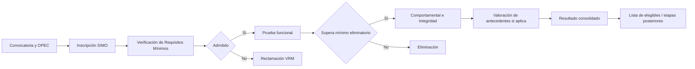
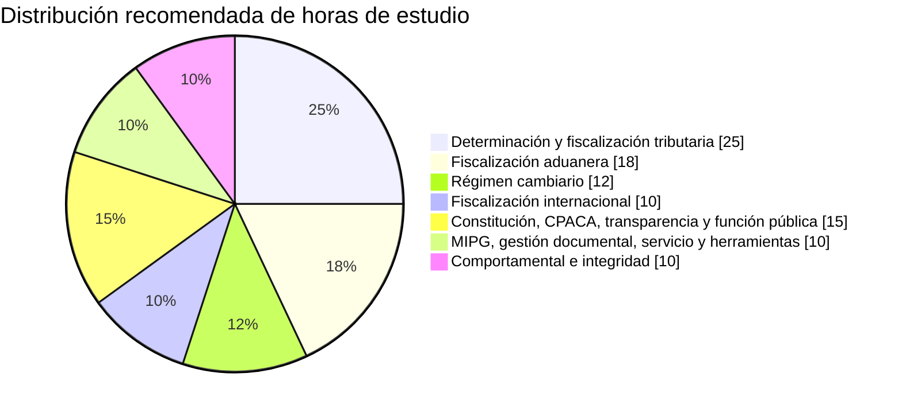
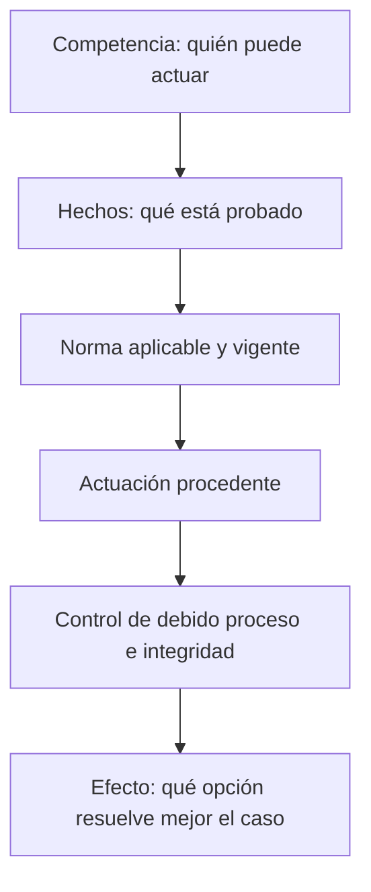
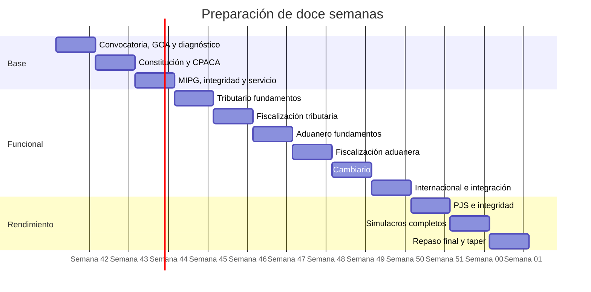

# Informe de preparación de procesos de selección y concursos para maximizar el puntaje

## Resumen ejecutivo

Aunque la solicitud parte de un proceso “no específico”, el documento aportado permite identificar un caso objetivo mucho más concreto: **DIAN — Gestor I, código 301, grado 01, nivel profesional, ficha AT-FL-3008, subproceso Fiscalización y Liquidación**. La ficha establece que **no requiere experiencia** y que el propósito del empleo es realizar investigaciones, actuaciones y trámites de verificación de obligaciones tributarias, aduaneras y cambiarias, incluyendo detección de evasión, elusión, contrabando y otras prácticas; también incluye la expedición de actos administrativos, acciones de fiscalización, planeación logística, informes y otras actividades de control. En la página 1 aparecen además 17 competencias funcionales/básicas y cuatro núcleos funcionales especializados: determinación y control tributario, régimen cambiario, fiscalización internacional y fiscalización aduanera. La página 2 asigna niveles a comportamiento ético, adaptabilidad, comunicación efectiva y trabajo en equipo. fileciteturn0file0

Esto cambia sustancialmente la recomendación: **la preparación debe ser principalmente jurídica-aplicada y situacional, no una memorización indiscriminada de leyes**. La ficha exige transformar normas en decisiones: identificar competencia, hecho relevante, procedimiento, evidencia, actuación correcta y conducta institucional. fileciteturn0file0

El proceso público actualmente más relevante para contrastar esa preparación es **DIAN 2676**, regido por el Acuerdo No. 21 del 7 de noviembre de 2025 y su anexo técnico. A fecha del **15 de octubre de 2026**, la CNSC publicó los resultados de Verificación de Requisitos Mínimos el 14 de octubre y abrió reclamaciones para no admitidos los días 15 y 16 de octubre; además, la Guía de Orientación al Aspirante para las pruebas escritas está publicada desde el 8 de octubre. La propia CNSC enfatiza que la VRM no es una prueba sino una condición obligatoria de participación. citeturn22search0turn22search3turn22search8

**Advertencia crítica:** la ficha AT-FL-3008 por sí sola no identifica la OPEC concreta en la que el aspirante está inscrito. Antes de asumir ponderaciones, debe confrontarse en SIMO la **OPEC + modalidad de participación + ficha MERF**. La CNSC explica que cada OPEC identifica un empleo y que un empleo puede contener varias vacantes; además, la DIAN funciona con planta global y flexible. citeturn19search0

Si la OPEC correspondiente a esta ficha está en **Ingreso y no exige experiencia**, DIAN 2676 utiliza la combinación más favorable para enfocar el entrenamiento: **competencias funcionales 70%, eliminatorias y con mínimo aprobatorio 70/100; comportamentales 20%; integridad 10%; sin valoración de antecedentes**. Para empleos de ingreso que sí requieren experiencia, la distribución es 65% funcional, 15% comportamental, 10% integridad y 10% antecedentes. citeturn18search2turn18search5

La consecuencia estratégica es clara:

> **Para aspirar a un resultado cercano al máximo, no prepare para “pasar con 70”. Prepare para sostener al menos 90–95% de precisión en simulaciones funcionales nuevas, bajo tiempo, y elimine sistemáticamente cada error recurrente.**

La investigación educativa respalda un programa basado en **recuperación activa, pruebas repetidas, retroalimentación y práctica espaciada**, no en sucesivas relecturas. Estudios experimentales muestran mayor retención con testing repetido y feedback que con relectura, incluso semanas después; otros trabajos encuentran efectos particularmente fuertes cuando las recuperaciones se distribuyen en el tiempo. citeturn25search0turn25search1turn25search3turn25search13

### Prioridades de preparación

| Prioridad | Objetivo | Razón |
|---|---|---|
| **Crítica** | Confirmar OPEC, modalidad y ficha en SIMO | Las ponderaciones dependen de ingreso/ascenso, experiencia y reserva. citeturn19search0turn22search4 |
| **Crítica** | Dominar la GOA oficial de DIAN 2676 | Define formato, tipos de ítem, reglas de aplicación y alcance de las pruebas. citeturn20search3turn22search3 |
| **Crítica** | Determinación/control tributario + fiscalización | Es competencia funcional expresa del empleo y está directamente conectada con su propósito. fileciteturn0file0 |
| **Muy alta** | Fiscalización aduanera | Es competencia funcional expresa; el Decreto 1165 debe estudiarse en compilación vigente porque ha sufrido modificaciones. fileciteturn0file0 citeturn23search2 |
| **Muy alta** | Régimen cambiario | Es competencia funcional expresa y debe estudiarse junto con la regulación del Banco de la República. fileciteturn0file0 citeturn23search6turn23search12 |
| **Muy alta** | CPACA, Constitución, transparencia, función pública | Aparecen expresamente en la ficha. fileciteturn0file0 |
| **Alta** | MIPG, integridad, servicio al ciudadano, gestión documental | También son competencias expresas y alimentan tanto PJS como pruebas comportamentales/integridad. fileciteturn0file0 citeturn24search1turn24search11 |
| **Alta** | Entrenamiento PJS | La preparación debe convertir conocimiento normativo en elección de la actuación institucional más adecuada. La reproducción indexada de la GOA reporta ese formato para funcionales. citeturn18search2 |
| **Media** | Psicometría genérica | En DIAN 2676 no sustituye las pruebas expresamente convocadas; es más relevante en otros regímenes, como SERVIR Perú. citeturn25search5 |
| **Baja para este cargo** | Entrevista/prueba práctica física | No aparece como componente general de Gestor I en el esquema DIAN analizado; en otros concursos sí puede ser decisiva. |

## Diagnóstico del proceso, formato y ponderaciones

### Lo que exige específicamente la ficha de Gestor I

La página 1 del documento aportado constituye el **mapa de estudio más importante**. No conviene preparar un temario genérico de “DIAN”; hay que traducir literalmente propósito, funciones y competencias del empleo en escenarios de examen. fileciteturn0file0

| Área de la ficha AT-FL-3008 | Contenido que debe dominarse | Forma probable de evaluación |
|---|---|---|
| Propósito | Verificación de obligaciones tributarias, aduaneras y cambiarias; evasión, elusión, abuso, contrabando y LA/FT | Caso situacional con hechos y alternativas de actuación |
| Investigación | Facultades, evidencia, requerimientos, documentos, competencia | PJS jurídico-procedimental |
| Actos administrativos | Actos de trámite, preparatorios y de fondo | Identificar actuación jurídicamente correcta |
| Fiscalización | Tributaria, aduanera, cambiaria | Casos integrados |
| Planeación | Logística de acciones de control | Priorización y toma de decisiones |
| Gestión | Informes estadísticos y de gestión | Herramientas, trazabilidad, calidad |
| Función pública | Constitución, CPACA, transparencia, integridad, MIPG | PJS transversal |
| Tributario | Determinación y control | Funcional especializado |
| Aduanero | Fiscalización aduanera | Funcional especializado |
| Cambiario | Operaciones de competencia DIAN | Funcional especializado |
| Internacional | Fiscalización internacional | Funcional especializado |
| Comportamiento | Ética 4; trabajo en equipo 3; comunicación 2; adaptabilidad 2 | Autoinforme/comportamental |

Todo lo anterior está directamente descrito en las dos páginas de la ficha entregada. fileciteturn0file0

### Ponderaciones de DIAN 2676

El Acuerdo No. 21 de 2025 establece distintas matrices dependiendo de la modalidad y de si el empleo exige experiencia. La **única prueba eliminatoria es la funcional** y el mínimo de esa prueba es 70; comportamentales, integridad y valoración de antecedentes son clasificatorias cuando correspondan. citeturn18search2turn18search5

| Modalidad DIAN 2676 | Funcional | Comportamental | Integridad | Antecedentes | Observación estratégica |
|---|---:|---:|---:|---:|---|
| **Ingreso, empleo sin experiencia** | **70%**, eliminatoria, mín. 70 | **20%** | **10%** | — | **Escenario más compatible con AT-FL-3008 si la OPEC efectivamente corresponde a esta ficha** |
| Ingreso, con experiencia | 65%, eliminatoria, mín. 70 | 15% | 10% | 10% | Sigue predominando funcional |
| Ingreso reservado discapacidad | 65%, eliminatoria, mín. 70 | 15% | 10% | 10% | Reglas especiales de participación |
| Ascenso, con experiencia | 60%, eliminatoria, mín. 70 | 15% | 10% | 15% | Antecedentes ganan importancia |
| Ascenso, técnico/profesional sin experiencia | 65%, eliminatoria, mín. 70 | 20% | 10% | 5% | Menor peso de VA |
| Ascenso reservado discapacidad | 60%, eliminatoria, mín. 70 | 15% | 10% | 15% | Igual énfasis funcional |

Fuente de las ponderaciones: Acuerdo 21/GOA reproducido en la documentación del proceso. citeturn18search2turn18search5

**Esto no significa que 70 sea un buen objetivo.** Es únicamente el umbral eliminatorio de la prueba funcional. En un concurso de mérito, superar el mínimo no garantiza una posición competitiva; por eso el sistema de preparación que sigue emplea metas internas de 90–95% en material nuevo.

### Formato de las pruebas

La GOA de DIAN 2676 fue publicada oficialmente por la CNSC el 8 de octubre de 2026. citeturn20search3turn22search3 La reproducción indexada de esa guía describe:

- **Competencias funcionales:** Prueba de Juicio Situacional, con caso, enunciado y tres opciones de respuesta, una de ellas considerada la solución eficaz/correcta al problema planteado. citeturn18search2
- **Comportamentales e integridad:** autoinforme mediante afirmaciones con escala de acuerdo/desacuerdo; por ello no deben estudiarse como un cuestionario jurídico de “verdadero/falso”. citeturn18search2
- Una fuente secundaria que reproduce la tabla de la GOA reporta para nivel profesional **66 ítems funcionales, 60 comportamentales y 30 de integridad, 156 en total**. Conviene verificar estos números en el PDF de su propia GOA/citación antes de diseñar el cronómetro definitivo. citeturn18search4turn20search3

La distinción es fundamental: **conocimientos** se preparan preguntando “¿qué dice la norma?”; **PJS** exige además preguntarse “dadas estas circunstancias, ¿qué actuación corresponde primero, quién tiene competencia y cuál opción resuelve el problema sin violar procedimiento, integridad ni derechos?”.

### Flujo típico del proceso



En DIAN 2676, la CNSC especifica además que la VRM **no es una prueba**, mientras que las reclamaciones de pruebas escritas y valoración de antecedentes cuentan con ventanas propias a través de SIMO. citeturn22search0turn16search3

### Variación real entre instituciones y países

No existe un modelo universal de “oposición”.

| País / régimen | Componentes observados | Qué cambia frente a DIAN |
|---|---|---|
| **Colombia — CNSC/DIAN** | VRM, funcional, comportamental, integridad, VA según modalidad | Gran peso del juicio situacional funcional. citeturn18search2turn22search4 |
| **Perú — SERVIR, Ley del Servicio Civil** | Conocimientos obligatoria; psicométrica obligatoria; psicológica opcional; competencias; curricular; entrevista final | Mucho mayor presencia explícita de psicometría e entrevista. citeturn25search5 |
| **Perú — otros regímenes de empleo público** | Como mínimo pueden intervenir evaluación curricular, técnica/conocimientos y entrevista, según régimen | Las fases dependen de la norma laboral aplicable. citeturn25search21 |
| **México — Servicio Profesional de Carrera** | Conocimientos, habilidades/psicometría, experiencia, mérito, revisión documental y entrevista | En convocatorias concretas se aplican mínimos y ponderaciones diferentes; ejemplos oficiales han asignado alrededor de 30 puntos a entrevista y porcentajes/puntos propios al resto. citeturn25search6turn25search15 |
| **España — AGE/INAP** | Convocatoria y programa fijados en BOE; oposición/promoción interna según cuerpo | No debe trasladarse ninguna ponderación colombiana. La convocatoria de diciembre de 2025, por ejemplo, ofertó 2.512 plazas del Cuerpo General Administrativo por ingreso libre. citeturn26search2turn26search6 |

Por tanto, la parte genérica de este informe puede reutilizarse, pero **temario, corte, penalización de errores, ponderaciones y número de ejercicios siempre deben reconfirmarse en la convocatoria concreta**.

## Temario estratégico y recursos prioritarios

### Distribución recomendada del estudio

La siguiente distribución **no pretende ser una ponderación oficial del examen**. Es una asignación de horas propuesta a partir de la ficha AT-FL-3008 y del elevado peso funcional de un empleo de ingreso sin experiencia. fileciteturn0file0 citeturn18search2



### Mapa de contenidos

| Bloque | Qué estudiar | Profundidad |
|---|---|---|
| **Constitución** | Principios del Estado, derechos fundamentales, estructura estatal, función administrativa | Alta |
| **Procedimiento administrativo** | Principios, competencia, actuaciones, actos, notificación/comunicación, defensa, recursos en lo correspondiente al temario oficial | Muy alta |
| **Transparencia/servicio** | Acceso a información, atención al ciudadano, PQRSF | Media-alta |
| **MIPG** | Propósito, dimensiones/políticas relacionadas con talento, información, gestión documental, control y relación Estado-ciudadano | Media-alta |
| **Integridad** | Honestidad, respeto, compromiso, diligencia, justicia; aplicación a dilemas | Alta |
| **Tributario** | Obligación tributaria, declaraciones, determinación, facultades de fiscalización e investigación, pruebas y actuaciones de control | **Muy alta** |
| **Aduanero** | Obligación aduanera, importación/exportación, documentos soporte, controles, fiscalización, aprehensión/decomiso y actuaciones | **Muy alta** |
| **Cambiario** | Mercado cambiario, operaciones obligatoriamente canalizables, cuentas de compensación y distribución institucional de competencias | Alta |
| **Fiscalización internacional** | Casos transfronterizos y materias que la OPEC/ejes de su prueba concreten | Alta |
| **Gestión documental e informática** | Trazabilidad, integridad de expediente, seguridad y uso correcto de herramientas | Media |
| **Comportamental** | Ética, comunicación, equipo y adaptabilidad según niveles de la ficha | Alta |

La ficha AT-FL-3008 incorpora expresamente Constitución, Ley 1437, MIPG, herramientas informáticas, gestión documental, transparencia, servicio al ciudadano, PQRSF y las cuatro áreas funcionales especializadas. fileciteturn0file0

### Normas y conceptos funcionales de mayor retorno

En tributario, el artículo 684 del Estatuto Tributario otorga a la administración amplias facultades de fiscalización e investigación, entre ellas verificar declaraciones, adelantar investigaciones, requerir contribuyentes o terceros y exigir/examinar documentación. Es un excelente artículo “generador de PJS” porque permite construir casos sobre qué puede hacer la administración frente a inconsistencias. citeturn23search16

En aduanas, el Decreto 1165 de 2019 debe consultarse en **compilación vigente**, ya que la versión de la DIAN incorpora modificaciones posteriores, entre ellas cambios del Decreto 659 de 2024. La propia normativa admite fiscalización integral que puede involucrar obligaciones aduaneras junto con aspectos tributarios y cambiarios de competencia de la DIAN. citeturn23search2turn23search11

En cambios internacionales, la Resolución Externa 1 de 2018 del Banco de la República compendió y modificó el régimen de cambios; las operaciones de cambio y los procedimientos deben estudiarse en las páginas vigentes del Banco, no desde resúmenes históricos. citeturn23search6turn23search12 Las cuentas de compensación, por ejemplo, tienen obligaciones específicas de registro/reporte cuando se usan para operaciones correspondientes. citeturn23search8

En función pública, Función Pública define MIPG como el marco que permite dirigir, planear, ejecutar, hacer seguimiento, evaluar y controlar la gestión para producir resultados con integridad y calidad del servicio. citeturn24search10 El Código de Integridad trabaja cinco valores: **honestidad, respeto, compromiso, diligencia y justicia**. citeturn24search2turn24search11

### Recursos con enlaces y prioridad

| Prioridad | Recurso | Uso recomendado |
|---|---|---|
| **P0** | **Ficha MERF AT-FL-3008 aportada** | Convertir cada función y competencia en preguntas y casos. fileciteturn0file0 |
| **P0** | **CNSC — proceso DIAN 2676** | Fuente maestra para avisos, reglas y novedades del concurso. citeturn20search0turn22search8 |
| **P0** | **Acuerdo No. 21 de 2025** | Ponderaciones, modalidades, reglas vinculantes. citeturn18search5 |
| **P0** | **GOA de pruebas escritas DIAN 2676** | Formato, aplicación, ejemplos y logística. citeturn20search3turn22search3 |
| **P0** | **DIAN — Normograma/Compilación Jurídica** | Leer normas consolidadas y vigentes de tributario y aduanero. citeturn23search2turn23search16 |
| **P0** | **SIMO** | Confirmar OPEC, modalidad, ficha y resultados. La CNSC explica su utilización en su ABC. citeturn19search1 |
| **P1** | **Función Pública — MIPG** | Manual, documentos y políticas del modelo. citeturn24search1turn24search12 |
| **P1** | **Función Pública — Código de Integridad** | Preparar integridad mediante principios de acción, no eslóganes. citeturn24search11 |
| **P1** | **Función Pública — Gestor Normativo** | CPACA, transparencia y normativa administrativa. citeturn24search8 |
| **P1** | **Banco de la República — regulación cambiaria** | Fuente primaria del régimen de cambios internacionales. citeturn23search6turn23search12 |
| **P1** | **CNSC — tutoriales/videos de SIMO** | Procedimiento, documentación y operación de la plataforma; el ABC remite expresamente a estos videos. citeturn19search1 |
| **P1** | **Artículos sobre retrieval practice** | Diseñar el sistema de estudio y los repasos. citeturn25search0turn25search13 |
| **P2** | **Grupo Geard — reproducción/comentario de GOA** | Útil como apoyo de formato, nunca como sustituto de la fuente CNSC. citeturn18search2 |
| **P2** | **SIMO Test** | Práctica privada complementaria; contrastar toda respuesta normativa con la fuente oficial. citeturn18search0 |
| **P2** | **Editorial jurídica reconocida en papel** | Puede usarse una edición reciente de Estatuto Tributario/CPACA/aduanas de editorial jurídica consolidada, pero la versión electrónica oficial vigente debe prevalecer para estudiar cambios normativos. |

### Cómo construir su propio “libro de oposición”

En lugar de acumular diez manuales, prepare una carpeta maestra con esta estructura:

```text
00_Convocatoria-OPEC-GOA
01_MERF-AT-FL-3008
02_Constitucion-CPACA
03_Transparencia-PQRSF-Servicio
04_MIPG-Integridad-GestionDocumental
05_Tributario
06_Aduanero
07_Cambiario
08_FiscalizacionInternacional
09_PJS-Casos
10_Errores
11_Simulacros
```

La carpeta **10_Errores** debe convertirse en el documento de mayor valor durante las últimas semanas. Cada error debe registrar: pregunta, respuesta elegida, respuesta correcta, causa del error, regla que lo resuelve, fuente oficial y fecha de próximo repaso.

### Bancos de exámenes: qué vale y qué no

La CNSC utiliza guías y ejemplos oficiales para familiarización; el acceso a material de pruebas reales se encuentra sujeto a las reglas de reclamación y confidencialidad, por lo que **no debe esperarse un banco oficial público completo de cuadernillos reutilizables**. En procesos CNSC, el acceso a material está asociado a reclamaciones y existen restricciones sobre reproducción. citeturn0search1turn22search1

Por ello, el orden de confianza debe ser:

**GOA oficial y ejemplos oficiales > preguntas propias derivadas de normas > simuladores de calidad contrastados > bancos comerciales > preguntas anónimas de redes sociales.**

Los **50 ítems originales** que aparecen más adelante pueden utilizarse como banco inicial sin riesgo de memorizar respuestas filtradas de una prueba real.

## Estrategia de puntaje máximo y plan adaptable de doce semanas

### Método de estudio

La evidencia favorece una secuencia **estudiar → recuperar sin mirar → corregir → espaciar → mezclar temas → volver a examinar**. Pruebas repetidas con feedback han producido mejor retención que relecturas, incluso con demoras de varias semanas, y el espaciamiento mejora la retención a largo plazo. citeturn25search0turn25search1turn25search3turn25search13

Use diariamente cuatro capas:

**Comprensión normativa.** Lea el artículo, determine sujeto, supuesto, autoridad, acción, excepción y consecuencia.

**Recuperación cerrada.** Cierre la fuente y explique la regla de memoria.

**Aplicación PJS.** Cree un caso donde dos opciones parezcan razonables y decida por qué una es jurídicamente superior.

**Registro de error.** Clasifique el fallo como: desconocimiento, confusión normativa, lectura, exceso de inferencia, procedimiento, precipitación o tiempo.

La recuperación activa con feedback debe ocupar progresivamente más tiempo que la lectura. Esa recomendación se apoya en los estudios experimentales de testing repetido y retención. citeturn25search0turn25search20

### Regla para resolver PJS

Utilice la secuencia **C-H-N-A-C-E**:



Ante dos respuestas plausibles, prefiera normalmente aquella que:

1. respete la competencia del funcionario;
2. se base en hechos disponibles, no en suposiciones;
3. aplique el procedimiento correcto;
4. proteja defensa, transparencia e integridad;
5. deje trazabilidad documental; y
6. resuelva el problema institucional descrito.

Esta heurística deriva de la naturaleza de las funciones de la ficha y de las materias administrativas, de integridad y fiscalización que esta exige. fileciteturn0file0 citeturn24search11turn23search16

### Gestión del tiempo

Si su GOA/citación confirma el formato reportado para nivel profesional de **156 ítems en cinco horas**, el promedio bruto sería de aproximadamente **1 minuto 55 segundos por ítem**; esa cifra no debe convertirse en un límite uniforme porque el PJS funcional requiere más razonamiento que un autoinforme comportamental. La cantidad de ítems procede de una reproducción secundaria de la GOA y debe validarse directamente en el documento oficial. citeturn18search4turn20search3

Una distribución razonable de una sesión de 300 minutos sería:

| Bloque | Tiempo estratégico | Objetivo |
|---|---:|---|
| Funcionales | 150 min | Máxima precisión; ≈2:16 por ítem si son 66 |
| Comportamentales | 70 min | Leer con atención y mantener coherencia |
| Integridad | 35 min | Responder auténtica y consistentemente |
| Revisión | 35 min | Volver a marcadas/dudosas |
| Reserva | 10 min | Control de hoja, numeración y contingencias |

No es una regla CNSC; es una **estrategia propuesta**. Si la citación cambia duración o número de ítems, escale proporcionalmente.

Para funcionales aplique tres pasadas:

**Primera:** responda inmediatamente lo seguro.  
**Segunda:** resuelva dudas que requieran razonamiento.  
**Tercera:** revise ítems en los que detectó negaciones, excepciones, competencia o secuencia procedimental.

Nunca permita que un solo ítem absorba el tiempo de tres preguntas.

### Comportamentales e integridad

No intente “hackear” un autoinforme eligiendo siempre la alternativa socialmente más extrema. La preparación correcta consiste en entender qué significan en conducta observable las competencias del empleo y contestar con consistencia. La ficha específica exige comportamiento ético nivel 4, trabajo en equipo nivel 3 y comunicación/adaptabilidad nivel 2. fileciteturn0file0

Para integridad, convierta los cinco valores oficiales —honestidad, respeto, compromiso, diligencia y justicia— en escenarios: conflicto de interés, reconocimiento de errores, trato al ciudadano, uso de información, presión indebida, favoritismo, retrasos y cuidado de recursos. citeturn24search11turn24search13

### Manejo del estrés

El objetivo no es “eliminar” ansiedad sino impedir que interfiera con lectura y memoria de trabajo. La literatura experimental ha encontrado beneficios de intervenciones de respiración/mindfulness en ansiedad ante pruebas, aunque el tamaño del beneficio y la metodología varían entre estudios. citeturn12search13turn12search17

Rutina práctica:

**Antes del simulacro:** dos o tres minutos de respiración lenta y regular.  
**Durante:** cuando detecte aceleración, deje el lápiz unos segundos, haga una exhalación lenta y vuelva a leer solamente el hecho y lo que se pregunta.  
**Después:** no evalúe el simulacro emocionalmente; clasifique los errores.

### Plan completo de doce semanas

| Semana | Enfoque | Producto verificable | Meta de precisión |
|---|---|---|---:|
| **1** | OPEC, Acuerdo, GOA, MERF; diagnóstico de 80–100 ítems | Mapa de ejes + matriz de errores | Línea base |
| **2** | Constitución, función administrativa, CPACA | 80 flashcards + 40 casos | ≥75% |
| **3** | Transparencia, PQRSF, servicio, MIPG, integridad, gestión documental | 60 casos transversales | ≥80% |
| **4** | Sistema tributario + facultades de fiscalización | Fichas de artículos clave + 80 preguntas | ≥82% |
| **5** | Determinación/control tributario aplicado | 100 PJS tributarios | ≥85% |
| **6** | Aduanas: estructura, obligación, regímenes/documentos | Mapa de proceso + 80 preguntas | ≥85% |
| **7** | Fiscalización aduanera y casos integrados | 100 PJS aduaneros | ≥87% |
| **8** | Régimen cambiario | Mapa operación→canal→autoridad→control | ≥88% |
| **9** | Fiscalización internacional + integración tributario/aduanas/cambios | 80 PJS mixtos | ≥90% |
| **10** | Comportamentales, integridad y PJS difíciles | 3 pruebas cronometradas parciales | ≥90% funcional |
| **11** | Simulaciones completas + reparación de errores | 3–4 sesiones largas | ≥92% |
| **12** | Repaso espaciado, simulacro final, logística, reducción de carga | Cuaderno final de 20–30 páginas | **≥95% en errores ya entrenados** |

La progresión hacia mayor cantidad de testing y menor relectura es coherente con la evidencia de recuperación repetida con feedback. citeturn25search0turn25search13

### Gráfico del cronograma



Las fechas del diagrama ilustran una secuencia adaptable; **no representan el calendario oficial de DIAN**.

### Adaptación urgente al proceso actual

Si usted está efectivamente inscrito en DIAN 2676 y su citación confirma la jornada de prueba reportada para **8 de noviembre de 2026**, no existen doce semanas disponibles desde el 15 de octubre. La GOA oficial ya se encuentra publicada y el proceso está en etapa de pruebas, por lo que el plan debe comprimirse. citeturn22search3turn22search8

Use este sprint:

| Periodo | Trabajo |
|---|---|
| Días 1–3 | GOA + OPEC + MERF + diagnóstico intensivo |
| Días 4–8 | Tributario + CPACA |
| Días 9–12 | Aduanero |
| Días 13–15 | Cambiario + internacional |
| Días 16–18 | MIPG, servicio, integridad, comportamental |
| Días 19–21 | PJS mixtos cronometrados |
| Días 22–23 | Dos simulaciones largas + reparación |
| Día 24 | Repaso ligero, logística, descanso cognitivo |

En una compresión así, **no intente leer toda la legislación de principio a fin**. La prioridad debe ser ficha → eje → artículo/regla → pregunta → error → repaso.

## Banco original de preguntas y cinco simulacros

Los siguientes **50 ítems son originales**, diseñados para practicar el razonamiento exigido por la ficha y por un formato situacional; **no son preguntas filtradas ni reproducciones del examen CNSC**. Las fuentes conceptuales principales son la ficha aportada, el Normograma DIAN, Función Pública y Banco de la República. fileciteturn0file0 citeturn23search2turn23search16turn24search1turn23search12

Para cada simulacro: 1 punto por pregunta. Meta de preparación: **10/10 después de corregir; ≥9/10 en la primera exposición a un bloque nuevo**.

### Simulacro de función pública y marco institucional

**Caso/preguntas**

| Ítem | Pregunta | Opciones |
|---|---|---|
| 1 | ¿Qué actuación refleja mejor el propósito principal de AT-FL-3008? | A) Diseñar exclusivamente campañas de comunicación. B) Investigar y verificar obligaciones tributarias, aduaneras o cambiarias conforme a norma y procedimiento. C) Administrar exclusivamente nómina. |
| 2 | ¿Cuál aparece expresamente entre las materias básicas del empleo? | A) MIPG. B) Derecho penal internacional exclusivamente. C) Ingeniería civil. |
| 3 | ¿Cuál **no** es uno de los cinco valores generales del Código de Integridad del servicio público? | A) Justicia. B) Diligencia. C) Competitividad. |
| 4 | ¿Qué descripción corresponde mejor a MIPG? | A) Sistema exclusivamente presupuestal. B) Marco para dirigir, planear, ejecutar, seguir, evaluar y controlar gestión pública. C) Sistema exclusivo de contratación. |
| 5 | En DIAN 2676, la VRM es: | A) Una prueba clasificatoria. B) Una condición obligatoria, no una prueba. C) Una entrevista. |
| 6 | Para ingreso a un empleo que no exige experiencia, la funcional pondera: | A) 40%. B) 70%. C) 20%. |
| 7 | Esa prueba funcional es: | A) Eliminatoria. B) Solo orientativa. C) Entrevista. |
| 8 | El mínimo aprobatorio funcional es: | A) 50. B) 60. C) 70. |
| 9 | Un funcionario encuentra una instrucción interna incompatible con una norma superior vigente. ¿Qué debe priorizar? | A) La instrucción informal. B) El marco jurídico aplicable y la competencia correspondiente. C) La práctica más antigua sin verificar. |
| 10 | Al estudiar una disposición aduanera modificada varias veces, la fuente más segura es: | A) Una captura de redes. B) Una versión consolidada oficial vigente. C) Un resumen sin fecha. |

**Soluciones:** 1-B; 2-A; 3-C; 4-B; 5-B; 6-B; 7-A; 8-C; 9-B; 10-B.

**Explicación.** Los ítems 1 y 2 salen directamente de propósito y competencias de la ficha; 3 y 4 corresponden al Código de Integridad y MIPG; 5–8 reflejan las reglas de DIAN 2676; 9–10 entrenan jerarquía, legalidad y actualización normativa. fileciteturn0file0 citeturn24search10turn24search11turn22search0turn18search2

### Simulacro de determinación y fiscalización tributaria

| Ítem | Situación | Respuesta |
|---|---|---|
| 1 | La administración detecta posibles inconsistencias en una declaración. ¿Puede verificar su exactitud? A) Sí, dentro de sus facultades de fiscalización. B) Nunca. C) Solo con autorización del contribuyente. | |
| 2 | Para esclarecer hechos relevantes, ¿puede requerir información al contribuyente o a terceros en los términos legales? A) Sí. B) No. C) Solo verbalmente. | |
| 3 | ¿Puede exigir documentos que registren operaciones cuando existe obligación legal de llevarlos? A) Sí. B) No. C) Solo después de sentencia judicial. | |
| 4 | Un investigador aún no cuenta con evidencia suficiente para una conclusión de fondo. ¿Qué opción es mejor? A) Decidir de inmediato contra el administrado. B) Adelantar las diligencias legales necesarias para esclarecer los hechos. C) Ignorar la inconsistencia. | |
| 5 | La ficha de Gestor I contempla proferir: A) Actos de trámite, preparatorios y de fondo requeridos dentro del proceso. B) Únicamente circulares de prensa. C) Sentencias judiciales. | |
| 6 | Una acción de control requiere personal, documentos y coordinación. La ficha espera que el Gestor I: A) Improvise el día de la diligencia. B) Planifique su logística. C) Delegue todo fuera de la entidad. | |
| 7 | ¿Cuál competencia funcional está expresamente en la ficha? A) Determinación y control tributario. B) Diseño arquitectónico. C) Medicina laboral. | |
| 8 | Ante dos opciones, una produce un resultado rápido pero omite el procedimiento, y otra aplica competencia y garantías legales. ¿Cuál debe elegirse? A) La primera por rapidez. B) La segunda. C) Cualquiera. | |
| 9 | Un dato contradice la hipótesis inicial del investigador. ¿Qué conducta es más sólida? A) Omitirlo. B) Incorporarlo y revaluar la hipótesis. C) Eliminarlo del expediente. | |
| 10 | ¿Qué preparación genera mayor transferencia al examen? A) Memorizar solo títulos de leyes. B) Resolver casos vinculando hecho, norma, facultad y actuación. C) Leer sin autoevaluarse. | |

**Soluciones:** 1-A; 2-A; 3-A; 4-B; 5-A; 6-B; 7-A; 8-B; 9-B; 10-B.

El artículo 684 del Estatuto Tributario reconoce amplias facultades de fiscalización e investigación, incluyendo verificación de declaraciones, investigaciones, requerimientos y examen/exigencia de documentación; la ficha añade expedición de actos, logística y determinación/control tributario. citeturn23search16 fileciteturn0file0

### Simulacro de fiscalización aduanera

| Ítem | Pregunta |
|---|---|
| 1 | Una fiscalización aduanera puede, cuando corresponda, integrarse con aspectos tributarios y cambiarios de competencia de la DIAN. A) Verdadero. B) Falso. C) Solo con autorización privada. |
| 2 | Si una mercancía de procedencia extranjera carece del documento exigido para ampararla y se configura la causal normativa, la autoridad debe: A) Ignorar el hecho. B) Analizar la procedencia de las medidas aduaneras previstas, incluida aprehensión cuando corresponda. C) Convertir automáticamente el caso en asunto laboral. |
| 3 | Al responder una pregunta de aduanas, ¿qué es más seguro? A) Usar el texto original de 2019 sin revisar reformas. B) Consultar el Decreto 1165 compilado con sus modificaciones. C) Memorizar un blog antiguo. |
| 4 | Antes de concluir que existe infracción, el examinando debe comprobar: A) Hechos, sujeto, obligación, norma vigente y procedimiento. B) Solo el valor de la mercancía. C) Solo la opinión del investigador. |
| 5 | La ficha AT-FL-3008 incluye expresamente: A) Fiscalización aduanera. B) Gestión hospitalaria. C) Catastro minero. |
| 6 | También incluye participación en ciertas diligencias de destrucción de mercancía averiada, defectuosa o impropia. A) Verdadero. B) Falso. |
| 7 | Un caso PJS ofrece como opción “decomisar inmediatamente” sin verificar causal ni procedimiento. Frente a una opción que primero establece hechos y causal jurídica, debe preferirse: A) La primera. B) La segunda. C) Ambas indistintamente. |
| 8 | Una clasificación o característica técnica de mercancía es incierta. La respuesta profesional es: A) Inventarla. B) Obtener/verificar el soporte técnico requerido antes de decidir. C) Decidir por apariencia. |
| 9 | La trazabilidad documental de una diligencia es: A) Irrelevante. B) Compatible con las funciones de investigación y gestión documental. C) Contraria a la función pública. |
| 10 | El objetivo de aprender causales aduaneras para PJS es: A) Recitar números únicamente. B) Reconocer cuándo los hechos satisfacen o no los elementos de la causal. C) Evitar leer los hechos. |

**Soluciones:** 1-A; 2-B; 3-B; 4-A; 5-A; 6-A; 7-B; 8-B; 9-B; 10-B.

El Decreto 1165 compilado por DIAN recoge la regulación vigente y sus modificaciones; la doctrina DIAN reconoce la posibilidad de fiscalización aduanera integral y la normativa establece causales específicas para medidas como aprehensión. citeturn23search2turn23search11turn23search15 Las competencias y funciones de los ítems 5, 6 y 9 proceden de la ficha. fileciteturn0file0

### Simulacro de régimen cambiario e internacional

| Ítem | Pregunta |
|---|---|
| 1 | La regulación cambiaria de referencia debe consultarse prioritariamente en: A) Banco de la República y normas oficiales vigentes. B) Foros anónimos. C) Apuntes sin fecha. |
| 2 | La Resolución Externa 1 de 2018: A) Compendió y modificó regulación cambiaria. B) Es un código laboral. C) Regula exclusivamente contratación estatal. |
| 3 | Las importaciones y exportaciones de bienes se encuentran entre las operaciones clásicamente sujetas al régimen de canalización cambiaria. A) Verdadero. B) Falso. |
| 4 | Una cuenta bancaria extranjera debe registrarse siempre como cuenta de compensación solo por existir. A) Sí. B) No; depende de su utilización conforme al régimen. C) Solo si tiene saldo cero. |
| 5 | Una cuenta de compensación registrada tiene obligaciones de reporte de movimientos de acuerdo con la regulación aplicable. A) Verdadero. B) Falso. |
| 6 | La ficha del empleo exige expresamente conocer: A) Régimen cambiario en operaciones de cambio de competencia DIAN. B) Solo política monetaria. C) Solo contabilidad bancaria privada. |
| 7 | También exige: A) Fiscalización internacional. B) Cirugía internacional. C) Diplomacia consular. |
| 8 | En un caso mixto, la mejor respuesta separa: A) Competencia del Banco de la República, competencia de control correspondiente y obligación del particular. B) Todas las funciones como si fueran de una sola autoridad. C) Ninguna autoridad. |
| 9 | Si una norma cambiaria ha sido modificada después de sus apuntes, debe: A) Conservar la versión vieja para el examen. B) actualizarla desde fuente primaria. C) Promediar ambas versiones. |
| 10 | Para memorizar operaciones cambiarias, el mapa más útil es: A) Operación → obligación de canalización/reporte → sujeto → autoridad → evidencia. B) Lista alfabética sin relaciones. C) Copiar la norma cinco veces. |

**Soluciones:** 1-A; 2-A; 3-A; 4-B; 5-A; 6-A; 7-A; 8-A; 9-B; 10-A.

El Banco de la República identifica la Resolución Externa 1 de 2018 como el compendio regulatorio del régimen y explica, entre otros temas, el tratamiento de las cuentas de compensación; los componentes DIAN del simulacro derivan de la ficha aportada. citeturn23search6turn23search8turn23search12 fileciteturn0file0

### Simulacro integrador de juicio situacional

| Ítem | Caso |
|---|---|
| 1 | Un ciudadano solicita información pública no sometida aparentemente a reserva. Un compañero propone negarla para “evitar problemas”. ¿Mejor actuación? A) Negarla informalmente. B) Tramitarla con las reglas de transparencia y verificar si existe una excepción legal aplicable. C) Destruir la solicitud. |
| 2 | Detecta que cometió un error en un informe todavía corregible. ¿Qué conducta se alinea mejor con integridad? A) Ocultarlo. B) Reconocerlo, corregirlo por el conducto correspondiente y dejar trazabilidad. C) Culpar a un tercero. |
| 3 | En una diligencia surge una situación no prevista. ¿Qué demuestra adaptabilidad adecuada? A) Abandonar el procedimiento. B) Ajustar la actuación dentro del marco jurídico y del objetivo institucional. C) Ignorar el cambio. |
| 4 | Dos áreas sostienen interpretaciones diferentes y la actuación vence pronto. ¿Mejor respuesta? A) Confrontación personal. B) Comunicación clara, contraste de fuente vigente y coordinación para adoptar una decisión competente. C) No documentar la diferencia. |
| 5 | Hay indicios de incumplimiento, pero falta un documento decisivo que legalmente puede solicitarse. A) Sancionar sin más. B) Obtenerlo mediante la facultad/procedimiento aplicable antes de llegar a la conclusión. C) Suponer su contenido. |
| 6 | En un control aduanero, una opción propone una medida sin comprobar que los hechos encajen en la causal. Otra verifica primero los elementos jurídicos. A) Primera. B) Segunda. C) Son equivalentes. |
| 7 | Una operación cambiaria parece irregular, pero no se ha determinado si corresponde a la competencia de la DIAN. ¿Primer paso? A) Sancionar. B) Determinar naturaleza de la operación y competencia. C) Publicarla en redes. |
| 8 | Una tarea urgente puede terminarse rápido omitiendo el registro en el expediente. ¿Qué hacer? A) Omitir trazabilidad. B) Ejecutar con diligencia y mantener el registro exigible. C) Eliminar documentos anteriores. |
| 9 | En un PJS quedan dos opciones: una es legal pero no resuelve completamente el problema; otra es legal, competente y resuelve el caso respetando procedimiento. ¿Cuál? A) Primera. B) Segunda. C) La más corta. |
| 10 | Lleva 4 minutos atrapado en una pregunta y restan muchas. ¿Mejor estrategia? A) Seguir indefinidamente. B) Marcar, elegir provisionalmente si procede y volver en revisión. C) Abandonar la prueba. |

**Soluciones:** 1-B; 2-B; 3-B; 4-B; 5-B; 6-B; 7-B; 8-B; 9-B; 10-B.

La lógica del simulacro reúne transparencia, integridad, adaptabilidad, comunicación, fiscalización, competencia y gestión documental, todas ellas vinculadas al perfil del empleo; Función Pública define además las conductas asociadas a los valores de integridad. fileciteturn0file0 citeturn24search11turn24search16

### Cómo convertir estos cinco simulacros en un banco de alto rendimiento

No vuelva simplemente a responderlos. Para cada error cree **tres variantes**:

> misma norma + hechos diferentes;  
> mismos hechos + pregunta distinta;  
> mismo problema + distractor más convincente.

Así, 50 preguntas pueden convertirse en **150–200 ejercicios de recuperación**, que es mucho más útil que memorizar la letra correcta. La estrategia de pruebas repetidas con feedback está respaldada por estudios de retención a corto y largo plazo. citeturn25search0turn25search13

Use esta escala:

| Resultado nuevo | Diagnóstico |
|---:|---|
| 95–100% | Nivel objetivo |
| 90–94% | Competitivo, pero aún hay errores reparables |
| 85–89% | Conocimiento razonable; insuficiente para objetivo perfecto |
| 75–84% | Vulnerabilidad alta en PJS |
| <75% | Volver a fundamento + recuperación activa |

No confunda esta escala de entrenamiento con la escala oficial de calificación CNSC.

## Entrevistas, psicometría, pruebas prácticas y variantes institucionales

### Para DIAN Gestor I

No debe desviarse una cantidad significativa de tiempo a preparar una “entrevista DIAN” imaginaria si la convocatoria de su OPEC no la incluye. En el esquema de DIAN 2676 aquí analizado las etapas de puntuación se concentran en funcional, comportamental, integridad y, cuando corresponde, antecedentes. citeturn18search2turn22search4

Del mismo modo, las **pruebas de ejecución/prácticas** en procesos DIAN han sido específicas para determinados empleos; por ejemplo, en DIAN 2667 la CNSC informó una prueba de ejecución ligada a una OPEC cuyo propósito era la conducción de vehículos, no una prueba práctica general para todos los profesionales. citeturn5search7

### Cuando sí exista entrevista

Para procesos de Perú, México u otra institución que sí contemple entrevista, prepare una matriz **STAR**:

**Situación → Tarea → Acción → Resultado → Aprendizaje.**

Construya ocho historias reales para cubrir: ética, presión, error propio, conflicto, usuario difícil, trabajo en equipo, adaptación, logro y decisión basada en datos.

La preparación debe evitar respuestas abstractas como “soy muy responsable”. Una respuesta fuerte muestra:

> “Detecté X; mi responsabilidad era Y; analicé A/B; tomé la acción Z; documenté/consulté; el resultado fue R; aprendí L.”

SERVIR Perú incluye entrevista final obligatoria dentro del esquema de concursos bajo la Ley del Servicio Civil, junto con conocimientos, psicometría, evaluación curricular y, según el caso, competencias. citeturn25search5 En el Servicio Profesional de Carrera mexicano, convocatorias oficiales incluyen también entrevistas tras las etapas de conocimientos, habilidades, experiencia y mérito. citeturn25search6turn25search15

### Cuando sí exista prueba psicométrica

No se prepara como Derecho Tributario. Trabaje:

- comprensión de instrucciones;
- razonamiento verbal/numérico si la herramienta lo mide;
- velocidad sin sacrificar precisión;
- consistencia en autoinforme;
- tolerancia a sesiones largas.

Nunca trate de deducir una “personalidad perfecta” ítem por ítem. En pruebas de personalidad/integridad, respuestas artificialmente extremas pueden generar inconsistencias internas.

En Perú, SERVIR distingue expresamente evaluación **psicométrica obligatoria** y psicológica opcional en el régimen citado, demostrando por qué no debe extrapolarse el formato DIAN a todos los concursos. citeturn25search5

### Cuando sí exista prueba práctica

La estrategia debe ser **procedimiento observable**, no teoría:


Para una prueba informática, practique en el software real y cronometrado. Para conducción, equipos o tareas operativas, practique el procedimiento y criterios de seguridad. Para un caso jurídico escrito, practique estructura **hechos → problema → norma → análisis → conclusión**.

### Qué aprender de otros sistemas

España demuestra la importancia de estudiar **exclusivamente el programa de la convocatoria concreta**: la AGE mantiene procesos diferenciados por cuerpo, ingreso libre y promoción interna, y el seguimiento oficial se realiza a través de INAP/Administración/BOE. La convocatoria de diciembre de 2025 distingue, entre otros, Administrativo, Auxiliar, Gestión y cuerpos informáticos. citeturn26search0turn26search2turn26search9

México muestra que incluso dentro de un mismo Servicio Profesional de Carrera cambian mínimos y reglas: convocatorias oficiales han usado mínimos de 70 u 80 en conocimiento y distintas condiciones para habilidades y entrevista. citeturn25search6turn25search11

Perú muestra una estructura donde el **currículum y la entrevista** pueden tener relevancia mucho mayor que en el caso DIAN. citeturn25search5turn25search21

La regla universal, por tanto, es:

> **Nunca prepare el nombre del concurso; prepare el acuerdo/bases + OPEC/perfil + guía de aplicación + temario vigente de su plaza específica.**

## Checklist final de preparación

### Control documental y de convocatoria

- [ ] Confirmé en SIMO el **número OPEC exacto**, denominación, código y grado.
- [ ] Confirmé que la ficha vinculada a mi OPEC es efectivamente **AT-FL-3008** y no otra ficha de Gestor I.
- [ ] Confirmé modalidad: ingreso, ascenso o reserva.
- [ ] Confirmé si la OPEC **requiere o no experiencia**, porque ello cambia ponderaciones. citeturn18search2turn19search0
- [ ] Descargué Acuerdo 21, anexo y GOA oficial. citeturn18search5turn20search3
- [ ] Revisé mi estado de VRM en SIMO. A 15 de octubre de 2026, los resultados se publicaron el 14 de octubre y la CNSC estableció reclamaciones para no admitidos el 15–16 de octubre. citeturn22search0
- [ ] Confirmé directamente en citación/GOA fecha, ciudad, duración, documentos permitidos y restricciones.

### Dominio del temario

- [ ] Puedo explicar sin apuntes el propósito y las siete funciones de AT-FL-3008. fileciteturn0file0
- [ ] Domino las 17 competencias básicas señaladas en la ficha. fileciteturn0file0
- [ ] Domino determinación/control tributario.
- [ ] Puedo aplicar las facultades de fiscalización del Estatuto Tributario a casos. citeturn23search16
- [ ] Estudio el Decreto 1165 desde la compilación vigente y no desde una copia de 2019 desactualizada. citeturn23search2
- [ ] Puedo resolver casos de fiscalización aduanera.
- [ ] Puedo mapear operaciones del régimen cambiario desde fuentes de Banco de la República. citeturn23search6turn23search8
- [ ] Tengo mapa de fiscalización internacional acorde con los ejes de mi OPEC.
- [ ] Domino CPACA en los títulos/capítulos expresamente fijados por la ficha. fileciteturn0file0
- [ ] Puedo explicar MIPG y aplicarlo a escenarios institucionales. citeturn24search1turn24search10
- [ ] Puedo aplicar honestidad, respeto, compromiso, diligencia y justicia a dilemas concretos. citeturn24search11

### Control de calidad del estudio

- [ ] Al menos la mitad de mi tiempo final es recuperación activa/casos, no lectura.
- [ ] Todo error está clasificado y tiene fuente oficial asociada.
- [ ] Reviso errores después de 1, 3, 7 y 14 días.
- [ ] Practico bloques mezclados tributario–aduanas–cambiario, no únicamente temas aislados.
- [ ] He realizado simulaciones con reloj.
- [ ] Mi precisión en preguntas nuevas está en ≥90%.
- [ ] Mis errores antiguos están en ≥95% de corrección.
- [ ] Puedo explicar **por qué los dos distractores son incorrectos**, no solo reconocer la letra correcta.

La combinación de recuperación repetida, feedback y espaciamiento es consistente con los resultados de investigaciones sobre aprendizaje duradero. citeturn25search0turn25search1turn25search3

### Control de PJS

- [ ] Primero identifico exactamente qué pregunta el enunciado.
- [ ] Distingo hecho probado de inferencia.
- [ ] Identifico autoridad competente.
- [ ] Busco la norma/regla aplicable.
- [ ] Verifico secuencia procedimental.
- [ ] Descarto opciones que resuelven rápido pero violan procedimiento.
- [ ] Descarto opciones pasivas cuando la función exige actuar.
- [ ] Prefiero una respuesta que combine legalidad, eficacia, trazabilidad e integridad.
- [ ] Marco y abandono temporalmente cualquier ítem que exceda el presupuesto de tiempo.

### Día del examen

- [ ] Consulté la citación oficial, no una captura reenviada.
- [ ] Tengo identificación y materiales exactamente permitidos por GOA.
- [ ] Conozco previamente la sede/ruta.
- [ ] Sé mi presupuesto de tiempo por bloque.
- [ ] Tengo decidido el criterio para marcar dudas.
- [ ] No cambio una respuesta al final solo por ansiedad; la cambio únicamente porque detecté una razón concreta.
- [ ] Aplico respiración lenta si noto activación excesiva; intervenciones breves de respiración/mindfulness cuentan con evidencia experimental para ansiedad de evaluación, aunque no sustituyen preparación académica. citeturn12search13turn12search17
- [ ] Conservo minutos finales para control de correspondencia entre cuadernillo y hoja/respuestas.

### Umbrales para el objetivo de “puntaje perfecto”

Use estos criterios internos durante la preparación:

| Indicador | Objetivo antes del examen |
|---|---:|
| Preguntas funcionales nuevas | **≥92–95%** |
| Errores previamente estudiados | **≥98%** |
| Casos tributarios | ≥95% |
| Casos aduaneros | ≥92% |
| Casos cambiarios | ≥90–92% |
| Constitución/CPACA/MIPG | ≥95% |
| Simulación completa | ≥92% dos veces consecutivas |
| Ítems sin contestar por tiempo | 0 |
| Errores de lectura/negaciones | ≤1% |
| Respuestas cambiadas de correcta a incorrecta | Tendencia cercana a 0 |

Estos son **objetivos de entrenamiento, no cortes oficiales**. El único umbral oficial relevante señalado en las tablas de DIAN 2676 es el mínimo de 70 en la prueba funcional; el objetivo competitivo debe situarse mucho más arriba porque el concurso ordena por mérito y el propósito planteado es maximizar la puntuación, no simplemente superar la eliminación. citeturn18search2turn18search5

La preparación óptima para la ficha entregada puede resumirse en una fórmula:

> **MERF exacto + normativa oficial vigente + recuperación activa + cientos de decisiones situacionales + análisis de errores + simulación cronometrada = la estrategia con mayor probabilidad de acercarse al puntaje máximo.**

En este caso concreto, la ventaja no provendrá de memorizar más páginas que otros aspirantes, sino de **convertir con mayor precisión los hechos de cada caso en competencia, norma, procedimiento y decisión correcta**, exactamente el tipo de trabajo que la ficha de Gestor I — Fiscalización y Liquidación describe. fileciteturn0file0